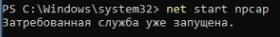
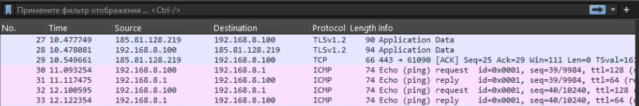
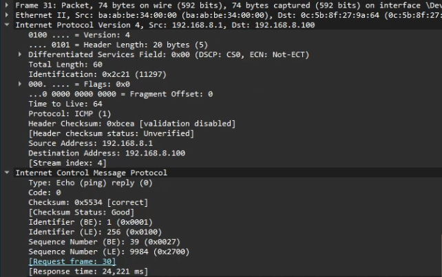
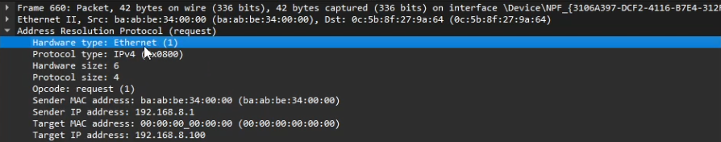
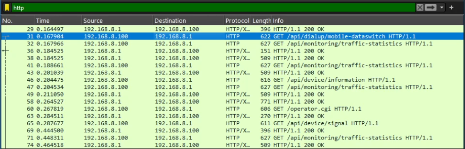
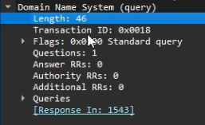
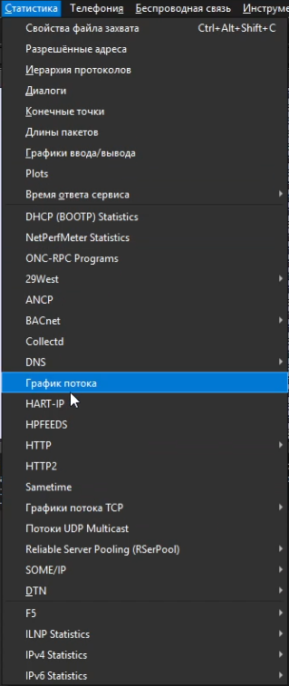
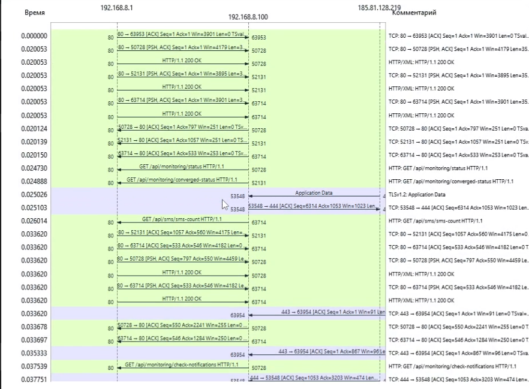

---
## Author
author:
  name: Гурбанов Сарча  
  email: 1032244850@rudn.ru
  affiliation:
    - name: Российский университет дружбы народов
      country: Российская Федерация
      postal-code: 117198
      city: Москва
      address: ул. Миклухо-Маклая, д. 6
## Title
title: "Лабораторная работа № 11"
subtitle: "Анализ трафика в Wireshark"
license: CC BY
date: "2026-10-10"
date-format: "YYYY-MM-DD"
---

# Информация

## Докладчик

- Гурбанов Сарча
- Студент
- Российский университет дружбы народов им. П. Лумумбы
- [1032244850@rudn.ru](mailto:1032244850@rudn.ru)
- <https://github.com/GurbanowS>

# Вводная часть

## Цель работы

Изучение посредством Wireshark кадров Ethernet, анализ PDU протоколов транспортного и прикладного уровней стека TCP/IP.

## Задачи

- Определить параметры подключения командой `ipconfig` в Windows.
- Определить MAC-адреса участников обмена и их типы.
- Подготовить Wireshark к захвату трафика.
- Проанализировать Ethernet II, ARP и ICMP.
- Рассмотреть HTTP-пакеты, поля TCP и DNS-запроса.
- Изучить обмен пакетами на графике потока.

# Выполнение лабораторной работы

# MAC-адресация

## Параметры сетевого подключения

- Команда `ipconfig` выводит адреса, маски и шлюзы интерфейсов.
- Ethernet 4: IPv4-адрес `192.168.8.100`, маска `255.255.255.0`.
- Шлюз IPv4: `192.168.8.1`.


## MAC-адреса участников обмена

Адреса определили по заголовкам Ethernet II в Wireshark.

| Устройство | IPv4-адрес | MAC-адрес |
| --- | --- | --- |
| Компьютер | `192.168.8.100` | `0c:5b:8f:27:9a:64` |
| Шлюз | `192.168.8.1` | `ba:ab:be:34:00:00` |

MAC-адрес содержит 48 бит, или 6 байт. В классическом формате глобально администрируемого адреса первые три байта образуют OUI, а последние три идентифицируют интерфейс в выделенном блоке адресов.

## Типы MAC-адресов

| Параметр | Компьютер | Шлюз |
| --- | --- | --- |
| Первый байт | `0c` | `ba` |
| Двоичная запись | `00001100` | `10111010` |
| Бит I/G | `0` | `0` |
| Бит U/L | `0` | `1` |
| Тип адреса | Индивидуальный, глобальный | Индивидуальный, локальный |

Бит I/G определяет индивидуальную или групповую адресацию. Бит U/L определяет способ администрирования адреса. Для локального адреса шлюза префикс не даёт достоверных сведений о производителе.

# Анализ кадров канального уровня в Wireshark

## Служба захвата пакетов Npcap

Проверили службу командой:

```powershell
net start npcap
```

Система сообщила, что служба уже запущена.



## Интерфейсы Wireshark

- Запустили Wireshark и открыли список интерфейсов.
- В списке доступны Ethernet 4, Ethernet 2 и виртуальные подключения.
- Далее рассмотрели трафик компьютера `192.168.8.100`.


## Проверка доступности шлюза

```powershell
ping 192.168.8.1
```

- На скриншоте видны три ответа с 32 байтами данных.
- Время отклика: 24, 21 и 31 мс.
- TTL ответов: 64.


## Дополнительная проверка доступности

```powershell
ping 192.168.137.1
```

- Отправлено 4 пакета, получено 4 ответа, потери 0 %.
- Минимальное время: 2 мс, максимальное: 9 мс, среднее: 4 мс.
- TTL ответов: 128.


## Захваченные пакеты

- В списке видны TLS, TCP и ICMP.
- Компьютер `192.168.8.100` отправляет эхо-запросы шлюзу `192.168.8.1`.
- Шлюз отправляет эхо-ответы в обратном направлении.



## Фильтр ARP и ICMP

Применили фильтр отображения:

```text
arp or icmp
```

В списке остались сообщения ARP и ICMP. Запрос № 30 и ответ № 31 образуют пару ICMP Echo.


## Кадры ICMP Echo

| Параметр | Запрос № 30 | Ответ № 31 |
| --- | --- | --- |
| Тип кадра | Ethernet II | Ethernet II |
| Длина кадра | 74 байта | 74 байта |
| Источник IPv4 | `192.168.8.100` | `192.168.8.1` |
| Получатель IPv4 | `192.168.8.1` | `192.168.8.100` |
| TTL | 128 | 64 |

В запросе MAC-адрес источника принадлежит компьютеру, адрес назначения принадлежит шлюзу. В ответе они меняются местами.

Размер кадра: 14 байт Ethernet II, 20 байт IPv4, 8 байт ICMP и 32 байта данных. Всего 74 байта.

## Заголовок эхо-ответа ICMP

- Тип ICMP: `Echo reply (0)`, код `0`.
- Идентификатор: `1`, номер последовательности BE: `39`.
- Wireshark связывает ответ с запросом № 30.
- Время ответа: `24,221 мс`.



## Заголовок ARP-запроса

- Длина захваченного кадра: 42 байта, тип Ethernet II.
- Opcode: `Request (1)`, тип разрешаемого протокола: IPv4 (`0x0800`).
- Отправитель IPv4: `192.168.8.1`, искомый адрес IPv4: `192.168.8.100`.
- Поле Target MAC address внутри ARP заполнено нулями.



## Сопоставление IPv4 и MAC в ARP

В списке пакетов показан запрос шлюза:

```text
Who has 192.168.8.100? Tell 192.168.8.1
```

Компьютер отвечает:

```text
192.168.8.100 is at 0c:5b:8f:27:9a:64
```

В раскрытом запросе MAC-адрес назначения Ethernet равен `0c:5b:8f:27:9a:64`. Этот кадр адресован конкретному компьютеру. Поле адреса получателя Ethernet и поле Target MAC внутри ARP относятся к разным заголовкам.

# Анализ протоколов транспортного и прикладного уровней

## HTTP-сайт в браузере

Открыли сайт `http://info.cern.ch/`. На странице доступны ссылки на первый веб-сайт и материалы об истории Всемирной паутины.


## HTTP-запросы и ответы

- Фильтр отображения: `http`.
- В списке показан обмен компьютера `192.168.8.100` с локальным шлюзом `192.168.8.1`.
- Видны запросы `GET` к `/api/monitoring/traffic-statistics` и другим ресурсам.
- Статус `HTTP/1.1 200 OK` означает успешную обработку запроса.



## Заголовок TCP

- Порт отправителя: `56124`, порт получателя: `80`.
- Длина данных: `556` байт, длина заголовка: `32` байта.
- Относительные номера: `Seq = 1`, `Ack = 1`.
- Флаги: PSH и ACK, поле окна: `252`.


## Номера последовательности и подтверждения

- `Seq` указывает номер первого байта данных сегмента.
- `Ack` указывает номер следующего ожидаемого байта от другой стороны.
- При передаче 556 байтов с `Seq = 1` следующий номер равен `557`.

```text
Next Seq = Seq + Len = 1 + 556 = 557
```

Подтверждение ACK без данных само по себе не увеличивает номер последовательности.

## DNS-запрос

- Тип сообщения: `Standard query`, идентификатор: `0x0018`.
- Запрос содержит один вопрос: `Questions = 1`.
- Записи Answer, Authority и Additional отсутствуют.
- Wireshark указывает связанный ответ в пакете № `1543`.



# Анализ TCP с помощью графика потока

## Открытие графика потока

В меню «Статистика» выбрали пункт «График потока».



## График обмена пакетами

- Участники: `192.168.8.1`, `192.168.8.100` и `185.81.128.219`.
- Стрелки показывают направление передачи, слева указано время.
- Видны HTTP-запросы, ответы `200 OK`, TCP-подтверждения и данные TLS.



## Изменение номера подтверждения TCP

График показывает обмен уже установленных соединений. Значения `Seq` и `Ack` сравниваются в пределах одного TCP-соединения.

Для соединения с портом клиента `50728` видны:

| Параметр | Значение |
| --- | --- |
| Ранее показанный Ack | `797` |
| Последующий Ack | `2241` |
| Разница | `1444` байта |

Рост `Ack` соответствует подтверждению ещё 1444 байтов данных в данном направлении.

# Заключение

## Выводы

- Определили IPv4-адрес компьютера, маску подсети и шлюз в Windows.
- По заголовкам Ethernet II определили MAC-адреса участников и их типы.
- Проанализировали сообщения ICMP и ARP, HTTP-обмен, поля TCP и DNS-запроса.
- По графику потока рассмотрели направления передачи и изменение подтверждений TCP.

## Источник

Королькова А. В., Кулябов Д. С. Сетевые технологии. Лабораторный практикум. Лабораторная работа № 11 «Анализ трафика в Wireshark». С. 125-135.
