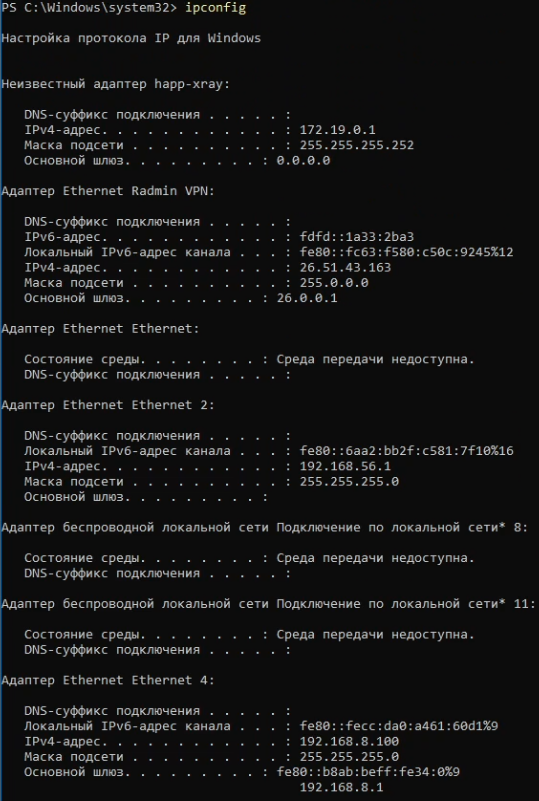
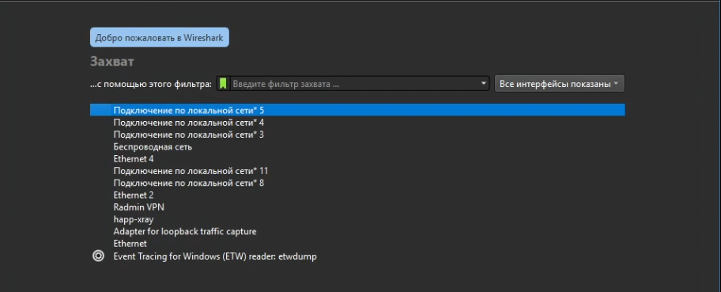
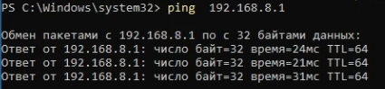
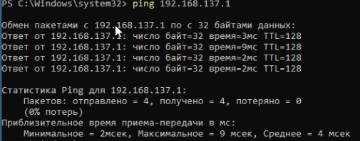
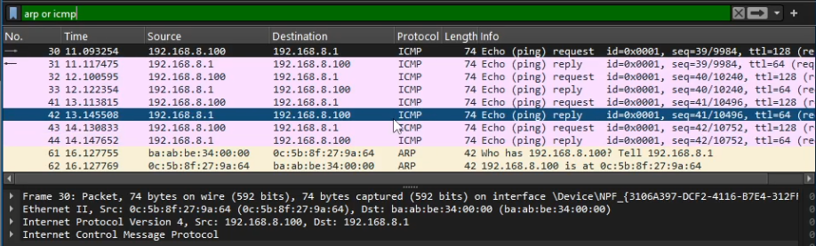
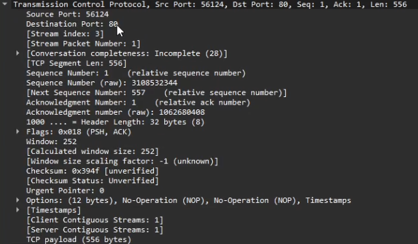

---
## Author
author:
  name: Гурбанов Сарча 
  email: 1032244850@rudn.ru
  affiliation:
    - name: Российский университет дружбы народов
      country: Российская Федерация
      postal-code: 117198
      city: Москва
      address: ул. Миклухо-Маклая, д. 6

## Title
title: "Домашняя работа № 3"
subtitle: "Анализ трафика в Wireshark"
license: "CC BY"
abstract: |
  В отчёте представлены результаты анализа сетевого трафика в Wireshark.
  Определены параметры сетевого подключения в Windows и MAC-адреса участников
  обмена. Рассмотрены кадры Ethernet II, сообщения ARP и ICMP, HTTP-запросы,
  поля заголовка TCP и DNS-запрос. Проанализирован график потока пакетов.
keywords: [Wireshark, Ethernet, ARP, ICMP, TCP, HTTP, DNS]
---

# Введение

Wireshark позволяет просматривать захваченные пакеты и исследовать их структуру на разных уровнях стека TCP/IP. В лабораторной работе использовались консоль Windows, браузер и Wireshark. Анализ проводился по сведениям о сетевых интерфейсах, списку пакетов, раскрытым заголовкам протоколов и графику потока.

# Цель работы

Изучение посредством Wireshark кадров Ethernet, анализ PDU протоколов транспортного и прикладного уровней стека TCP/IP.

# Задачи

- Определить параметры сетевого подключения с помощью команды `ipconfig`.
- Определить MAC-адрес устройства и типы MAC-адресов участников обмена.
- Подготовить Wireshark к захвату трафика.
- Проанализировать кадры Ethernet II с сообщениями ARP и ICMP.
- Рассмотреть HTTP-пакеты, заголовок TCP и поля DNS-запроса.
- Проанализировать обмен пакетами с помощью графика потока.

# Выполнение лабораторной работы

## MAC-адресация

### Определение параметров сетевого подключения

В консоли Windows выполнили команду:

```powershell
ipconfig
```

В результате получили сведения о физических и виртуальных сетевых адаптерах: IPv4- и IPv6-адреса, маски подсетей, основные шлюзы и состояние подключения (рис. 1).



Основные параметры IPv4, представленные в выводе команды:

| Интерфейс | IPv4-адрес | Маска подсети | Основной шлюз IPv4 |
| --- | --- | --- | --- |
| happ-xray | `172.19.0.1` | `255.255.255.252` | `0.0.0.0` |
| Radmin VPN | `26.51.43.163` | `255.0.0.0` | `26.0.0.1` |
| Ethernet 2 | `192.168.56.1` | `255.255.255.0` | Не указан |
| Ethernet 4 | `192.168.8.100` | `255.255.255.0` | `192.168.8.1` |

Для адаптера `Ethernet` и двух показанных адаптеров беспроводной локальной сети указано, что среда передачи недоступна.

В исследуемом обмене участвовал компьютер с адресом `192.168.8.100`. Его маска `255.255.255.0` соответствует префиксу `/24`, а адрес сети равен `192.168.8.0`. Шлюз `192.168.8.1` находится в той же подсети и обеспечивает передачу пакетов за её пределы.

### Структура и типы MAC-адресов

MAC-адреса участников обмена определили по полям `Source` и `Destination` заголовка Ethernet II в Wireshark:

| Устройство | IPv4-адрес | MAC-адрес |
| --- | --- | --- |
| Компьютер | `192.168.8.100` | `0c:5b:8f:27:9a:64` |
| Шлюз | `192.168.8.1` | `ba:ab:be:34:00:00` |

MAC-адрес содержит 48 бит, то есть 6 байт. В классическом формате глобально администрируемого адреса первые три байта образуют идентификатор производителя OUI, а последние три байта идентифицируют сетевой интерфейс в пределах выделенного производителю блока адресов.

Для адреса компьютера `0c:5b:8f:27:9a:64` префикс равен `0c:5b:8f`, а оставшаяся часть - `27:9a:64`.

Тип адреса определяется двумя младшими битами первого байта. Бит I/G показывает, является ли адрес индивидуальным или групповым, а бит U/L - глобально или локально администрируемым.

| MAC-адрес | Первый байт в двоичном виде | I/G | U/L | Тип адреса |
| --- | --- | --- | --- | --- |
| `0c:5b:8f:27:9a:64` | `00001100` | `0` | `0` | Индивидуальный, глобально администрируемый |
| `ba:ab:be:34:00:00` | `10111010` | `0` | `1` | Индивидуальный, локально администрируемый |

Таким образом, оба адреса используются для адресной передачи кадров отдельному получателю. Адрес шлюза имеет установленный бит U/L, поэтому его префикс нельзя использовать как достоверный идентификатор производителя.

## Анализ кадров канального уровня в Wireshark

### Подготовка к захвату трафика

Проверили состояние службы захвата пакетов Npcap командой:

```powershell
net start npcap
```

Система сообщила, что запрошенная служба уже запущена (рис. 2).


Запустили Wireshark. В стартовом окне отображается список доступных интерфейсов, включая `Ethernet 4`, `Ethernet 2`, `Radmin VPN`, беспроводные и виртуальные подключения (рис. 3).



### Проверка доступности шлюза

Для генерации ICMP-пакетов выполнили:

```powershell
ping 192.168.8.1
```

В показанном фрагменте получены три ответа от шлюза. Размер данных каждого ответа составляет 32 байта, время отклика - 24, 21 и 31 мс, значение TTL - 64 (рис. 4).



Также была выполнена отдельная проверка доступности адреса `192.168.137.1` (рис. 5). Отправлено 4 пакета и получено 4 ответа, потери составили 0 %. Минимальное время отклика равно 2 мс, максимальное - 9 мс, среднее - 4 мс. В ответах указано TTL 128.



### Фильтрация захваченных пакетов

В списке захвата видны пакеты разных протоколов: TLS, TCP и ICMP. ICMP-запросы направлены от `192.168.8.100` к `192.168.8.1`, а ответы идут в обратном направлении (рис. 6).


Для анализа кадров канального уровня применили фильтр отображения:

```text
arp or icmp
```

После фильтрации в списке остались ICMP-запросы, ICMP-ответы и сообщения ARP (рис. 7).



### Анализ эхо-запроса и эхо-ответа ICMP

Рассмотрели эхо-запрос № 30 и соответствующий эхо-ответ № 31. В раскрытом заголовке запроса указаны тип кадра `Ethernet II`, MAC-адрес компьютера и MAC-адрес шлюза. В ответе эти адреса меняются местами.

| Параметр | Эхо-запрос № 30 | Эхо-ответ № 31 |
| --- | --- | --- |
| Длина захваченного кадра | 74 байта, 592 бита | 74 байта, 592 бита |
| Тип кадра | Ethernet II | Ethernet II |
| IPv4-адрес источника | `192.168.8.100` | `192.168.8.1` |
| IPv4-адрес назначения | `192.168.8.1` | `192.168.8.100` |
| MAC-адрес источника | `0c:5b:8f:27:9a:64` | `ba:ab:be:34:00:00` |
| MAC-адрес назначения | `ba:ab:be:34:00:00` | `0c:5b:8f:27:9a:64` |
| Сообщение ICMP | Echo request | Echo reply |
| TTL | 128 | 64 |

Оба кадра передаются индивидуальному получателю. MAC-адрес компьютера глобально администрируемый, MAC-адрес шлюза - локально администрируемый.

Подробно раскрыли заголовки эхо-ответа (рис. 8). Длина заголовка IPv4 составляет 20 байт, общая длина IP-пакета - 60 байт. Значение поля `Protocol` равно `ICMP (1)`.


В заголовке ICMP указаны тип `Echo reply (0)`, код `0`, идентификатор `1` и номер последовательности `39` при представлении в порядке байтов BE. Wireshark связывает ответ с запросом № 30 и показывает время ответа `24,221 мс`.

Размер кадра согласуется с размером данных команды `ping`: 14 байт заголовка Ethernet II, 20 байт заголовка IPv4, 8 байт заголовка ICMP и 32 байта данных дают 74 байта.

### Анализ сообщений ARP

В отфильтрованном списке видны запрос:

```text
Who has 192.168.8.100? Tell 192.168.8.1
```

и ответ:

```text
192.168.8.100 is at 0c:5b:8f:27:9a:64
```

Шлюз запрашивает MAC-адрес компьютера с IPv4-адресом `192.168.8.100`, а компьютер сообщает свой физический адрес (рис. 7).

В раскрытом ARP-запросе показаны следующие поля (рис. 9):

| Поле | Значение |
| --- | --- |
| Длина захваченного кадра | 42 байта, 336 бит |
| Тип кадра | Ethernet II |
| MAC-адрес источника Ethernet | `ba:ab:be:34:00:00` |
| MAC-адрес назначения Ethernet | `0c:5b:8f:27:9a:64` |
| Hardware type | Ethernet (`1`) |
| Protocol type | IPv4 (`0x0800`) |
| Hardware size | 6 байт |
| Protocol size | 4 байта |
| Opcode | Request (`1`) |
| Sender MAC address | `ba:ab:be:34:00:00` |
| Sender IP address | `192.168.8.1` |
| Target MAC address | `00:00:00:00:00:00` |
| Target IP address | `192.168.8.100` |


Поле `Protocol type = 0x0800` внутри ARP указывает на разрешение адреса IPv4. Значение EtherType для самого протокола ARP равно `0x0806`.

В данном запросе адрес назначения Ethernet является индивидуальным: кадр направлен конкретному компьютеру. При этом поле `Target MAC address` внутри ARP заполнено нулями. Адрес получателя кадра Ethernet и искомый адрес в сообщении ARP относятся к разным полям протоколов. При первоначальном поиске неизвестного MAC-адреса ARP также может использовать широковещательный адрес `ff:ff:ff:ff:ff:ff`.

## Анализ протоколов транспортного и прикладного уровней

### Просмотр HTTP-трафика

В браузере открыли сайт:

```text
http://info.cern.ch/
```

На странице отображаются ссылки на первый веб-сайт и материалы об истории Всемирной паутины (рис. 10).


В Wireshark применили фильтр:

```text
http
```

В представленном списке отображается HTTP-обмен компьютера `192.168.8.100` с локальным шлюзом `192.168.8.1` (рис. 11). Среди запросов видны:

```http
GET /api/dialup/mobile-dataswitch HTTP/1.1
GET /api/monitoring/traffic-statistics HTTP/1.1
GET /api/device/information HTTP/1.1
GET /operator.cgi HTTP/1.1
```


Метод `GET` используется для запроса ресурса по указанному пути. В списке ответов присутствует статус `HTTP/1.1 200 OK`, означающий успешную обработку запроса. Открытый HTTP-трафик позволяет прочитать метод, путь ресурса и статус ответа непосредственно в списке пакетов.

### Анализ заголовка TCP

В выбранном сегменте раскрыли заголовок TCP (рис. 12).



| Поле TCP | Значение | Назначение |
| --- | --- | --- |
| Source Port | `56124` | Порт отправителя |
| Destination Port | `80` | Порт HTTP-службы получателя |
| TCP Segment Len | `556` | Число байтов данных TCP |
| Sequence Number | `1` | Относительный номер первого байта данных сегмента |
| Next Sequence Number | `557` | Номер следующего байта после данных этого сегмента |
| Acknowledgment Number | `1` | Относительный номер следующего ожидаемого байта от другой стороны |
| Header Length | `32` байта | Длина заголовка с опциями |
| Flags | `0x018`, PSH и ACK | Передача данных с подтверждением |
| Window | `252` | Значение поля окна, указанное в заголовке |
| Urgent Pointer | `0` | Значение указателя срочных данных |

Wireshark показывает относительные номера последовательности и подтверждения. Для выбранного сегмента `Seq = 1`, а длина данных равна 556 байтам, поэтому следующий номер последовательности вычисляется как:

```text
Next Seq = Seq + Len = 1 + 556 = 557
```

Флаг ACK означает, что поле подтверждения значимо. Оно указывает номер следующего ожидаемого байта в противоположном направлении передачи. Флаг PSH используется для передачи принятых данных приложению без ожидания заполнения буфера. Среди опций заголовка видны `NOP` и `Timestamps`.

### Анализ DNS-запроса

В деталях пакета рассмотрели раздел `Domain Name System (query)` (рис. 13).


| Поле DNS | Значение |
| --- | --- |
| Length | `46` |
| Transaction ID | `0x0018` |
| Тип сообщения | Standard query |
| Questions | `1` |
| Answer RRs | `0` |
| Authority RRs | `0` |
| Additional RRs | `0` |
| Response In | Пакет № `1543` |

DNS-запрос содержит один вопрос. В нём отсутствуют записи ответа, записи полномочных серверов и дополнительные записи. Идентификатор транзакции используется для сопоставления запроса и ответа. Ссылка `Response In: 1543` показывает номер пакета, который Wireshark связал с данным запросом.

## Анализ TCP с помощью графика потока

В меню Wireshark выбрали пункт **«Статистика» → «График потока»** (рис. 14).


На графике представлены узлы `192.168.8.1`, `192.168.8.100` и `185.81.128.219`. Вертикальные линии соответствуют участникам обмена, стрелки показывают направление передачи, а слева указано время пакетов (рис. 15).


В показанном фрагменте отображается обмен данными уже установленных соединений. Между компьютером и шлюзом видны HTTP-запросы `GET`, ответы `HTTP/1.1 200 OK` и TCP-сегменты с флагами ACK и PSH, ACK. Для обмена с внешним узлом также показаны сообщения `TLSv1.2 Application Data`.

График содержит несколько TCP-соединений с разными портами клиента, поэтому значения `Seq` и `Ack` следует сравнивать в пределах одного соединения. Например, в соединении с портом клиента `50728` видны подтверждения с `Ack = 797`, а затем с `Ack = 2241`. Увеличение номера подтверждения на `2241 - 797 = 1444` соответствует подтверждению ещё 1444 байтов данных в этом направлении.

При передаче данных номер последовательности увеличивается на число переданных байтов. Подтверждение без данных само по себе не занимает место в пространстве номеров последовательности. Поля `Seq` и `Ack` позволяют определить, какие данные переданы и какие байты другая сторона ожидает получить следующими.

# Выводы

В ходе лабораторной работы определили параметры сетевых подключений Windows с помощью команды `ipconfig`. Для исследуемого компьютера установлены IPv4-адрес `192.168.8.100`, маска `/24` и шлюз `192.168.8.1`.

По заголовкам Ethernet II определены MAC-адреса компьютера и шлюза. Адрес компьютера является индивидуальным и глобально администрируемым, адрес шлюза - индивидуальным и локально администрируемым.

В Wireshark проанализированы ICMP-запросы и ответы длиной 74 байта, а также сообщения ARP, связывающие IPv4-адрес компьютера с его MAC-адресом. Рассмотрены HTTP-запросы и ответы локального шлюза, поля TCP и структура DNS-запроса. По графику потока изучены направления обмена и изменение номеров последовательности и подтверждения TCP при передаче данных.

# Список литературы {.unnumbered}

