---
## Author
author:
  name: Гурбанов Сарча  
  email: 1032244850@rudn.ru
  affiliation:
    - name: Российский университет дружбы народов
      country: Российская Федерация
      postal-code: 117198
      city: Москва
      address: ул. Миклухо-Маклая, д. 6
## Title
title: "Лабораторная работа № 4"
subtitle: "Адресация IPv4 и IPv6. Двойной стек"
license: CC BY
date: "2026-10-24"
date-format: "YYYY-MM-DD"
---
# Информация

## Докладчик

- Гурбанов Сарча
- Студент
- Российский университет дружбы народов им. П. Лумумбы
- [1032244850@rudn.ru](mailto:1032244850@rudn.ru)
- <https://gurbanovs.github.io/ru/>

# Вводная часть

## Цель и задачи

**Цель:** изучить принципы распределения и настройки адресного пространства на устройствах сети.

- Собрать топологию в GNS3.
- Настроить IPv4 на конечных узлах и FRR.
- Настроить IPv6 на конечных узлах и VyOS.
- Проверить параметры устройств и результаты диагностики.

# Выполнение лабораторной работы

## Топология сети в GNS3

- PC1 и PC2 подключены к FRR. PC3 и PC4 подключены к VyOS.
- Общий коммутатор соединяет сервер с обоими маршрутизаторами.


## План IPv4-адресации

| Устройство | Адрес | Шлюз |
| --- | --- | --- |
| FRR, eth0 | `172.16.20.1/25` | — |
| FRR, eth1 | `172.16.20.129/25` | — |
| FRR, eth2 | `64.100.1.1/24` | — |
| PC1 | `172.16.20.10/25` | `172.16.20.1` |
| PC2 | `172.16.20.138/25` | `172.16.20.129` |
| Server | `64.100.1.10/24` | `64.100.1.1` |

## IPv4-адрес PC2

```text
ip 172.16.20.138/25 172.16.20.129
save
```

Команда `save` сохраняет настройки VPCS в `startup.vpc`.

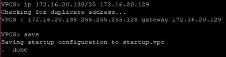

## IPv4-адрес сервера

```text
ip 64.100.1.10/24 64.100.1.1
save
```

Сервер использует интерфейс `eth2` маршрутизатора FRR как IPv4-шлюз.

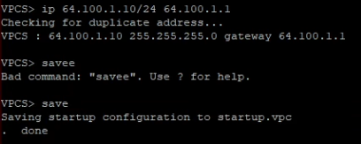

## Проверка адресации PC1

- IPv4-адрес: `172.16.20.10/25`.
- Шлюз: `172.16.20.1`.
- `show ipv6` показывает локальный адрес канала.

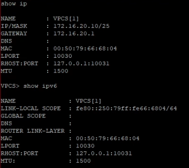

## Проверка адресации PC2

- IPv4-адрес: `172.16.20.138/25`.
- Шлюз: `172.16.20.129`.
- Поле глобального IPv6-адреса пустое.

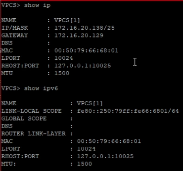

## Имя маршрутизатора FRR

```text
configure terminal
hostname msk-sgurbanov-gw-01
exit
write memory
```

FRR сохраняет конфигурацию в `/etc/frr/frr.conf`.

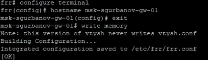

## Настройка интерфейсов FRR

- `eth0`: `172.16.20.1/25`.
- `eth1`: `172.16.20.129/25`.
- `eth2`: `64.100.1.1/24`.

Для каждого интерфейса выполнена команда `no shutdown`.

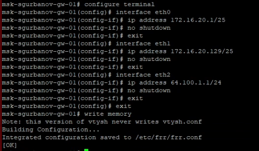

## Текущая конфигурация FRR

Команда `show running-config` показывает имя устройства и адреса трёх настроенных интерфейсов.

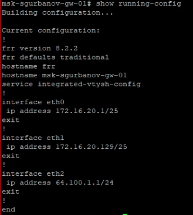

## Состояние интерфейсов FRR

Команда `show interface brief` подтверждает состояние `up` у `eth0`, `eth1` и `eth2`.

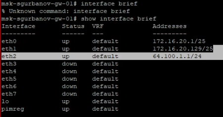

## Диагностика адреса 172.16.20.1

```text
ping 172.16.20.1
trace 172.16.20.1
```

Маршрутизатор получил ответы на все 14 запросов.


## Диагностика адреса 172.16.20.129

```text
ping 172.16.20.129
trace 172.16.20.129
```

Маршрутизатор получил ответы на все 9 запросов.


## Диагностика адреса 64.100.1.1

```text
ping 64.100.1.1
trace 64.100.1.1
```

Маршрутизатор получил ответы на все 9 запросов.


## Результаты локальной диагностики

| Адрес | Отправлено | Получено | Потери |
| --- | --- | --- | --- |
| `172.16.20.1` | 14 | 14 | 0 % |
| `172.16.20.129` | 9 | 9 | 0 % |
| `64.100.1.1` | 9 | 9 | 0 % |

Команды выполнялись на FRR и обращались к его собственным адресам. Результаты относятся к локальной проверке маршрутизатора.

# Настройка IPv6

## План IPv6-адресации

Адреса из задания:

| Устройство | IPv6-адрес |
| --- | --- |
| VyOS, eth0 | `2001:db8:c0de:12::1/64` |
| VyOS, eth1 | `2001:db8:c0de:13::1/64` |
| VyOS, eth2 | `2001:db8:c0de:11::1/64` |
| PC3 | `2001:db8:c0de:12::a/64` |
| PC4 | `2001:db8:c0de:13::a/64` |
| Server | `2001:db8:c0de:11::a/64` |

## IPv6-адрес PC3

```text
ip 2001:db8:c0de:12::a/64
save
```

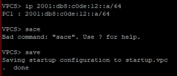

## IPv6-адрес PC4

```text
ip 2001:db8:c0de:13::a/64
save
```


## IPv6-адрес сервера

- На снимке: `2001:db8:11::a/64`.
- По заданию: `2001:db8:c0de:11::a/64`.

Введённый адрес содержит другой префикс. Для соответствия заданию требуется добавить группу `c0de`.


## Проверка IPv6 на PC3

Команды `show ip` и `show ipv6` подтверждают IPv6-адрес узла. IPv4-адрес не задан.


## Проверка IPv6 на PC4

В поле `GLOBAL SCOPE` указан адрес `2001:db8:c0de:13::a/64`. Также присутствует локальный адрес канала.

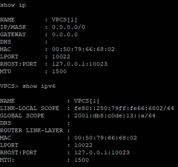

# Настройка маршрутизатора VyOS

## Подготовка конфигурации VyOS

Имя устройства: `msk-user-gw-02`.

Настройка получения адреса по DHCP на `eth0` уже отсутствовала.

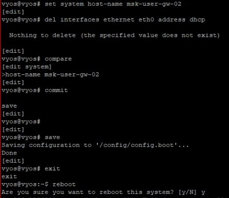

## IPv6-адрес интерфейса eth2

```text
set interfaces ethernet eth2 address 2001:db8:c0de:11::1/64
```

Интерфейс подключён к серверному сегменту.

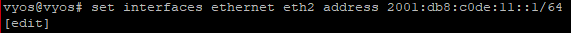

## Router Advertisement на eth2

Итоговая конфигурация содержит анонс префикса `2001:db8:c0de:11::/64`.

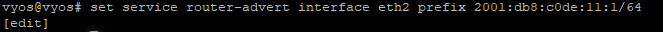

Команда `compare` показывает адрес интерфейса и анонсируемый префикс.

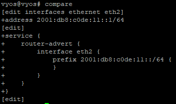

## Сохранение конфигурации VyOS

```text
commit
save
```

VyOS применяет изменения и сохраняет их в `/config/config.boot`.


## Проверка интерфейса eth2

Команда `show interfaces` показывает настроенный IPv6-адрес интерфейса `eth2`.


# Выводы

## Результаты работы

- Собрали топологию GNS3 с сегментами IPv4 и IPv6.
- Назначили адреса конечным узлам и трём интерфейсам FRR.
- Проверили состояние интерфейсов и собственные IPv4-адреса FRR. Потери пакетов составили 0 %.
- Настроили адрес `eth2` и Router Advertisement на VyOS, сохранили конфигурацию.
- Выявили несовпадение IPv6-префикса сервера с заданием.

## Источник

Королькова А. В., Кулябов Д. С. Сетевые технологии. Лабораторный практикум.

Лабораторная работа № 4 «Адресация IPv4 и IPv6. Двойной стек». С. 44–48.