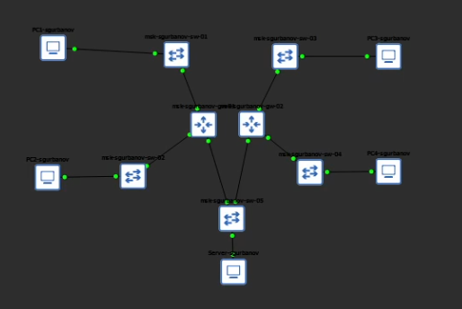
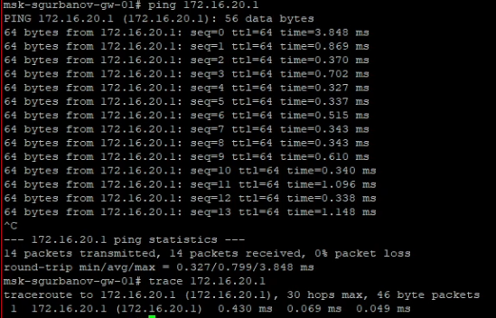
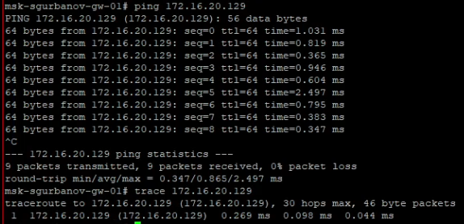
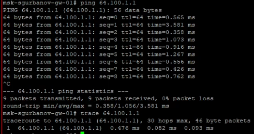
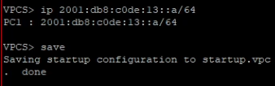
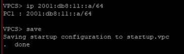
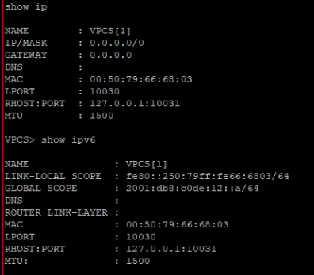
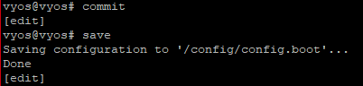
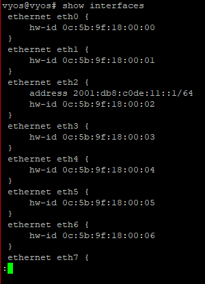

---
## Author
author:
  name: Гурбанов Сарча
  degrees: DSc
  orcid: 0000-0002-0877-7063
  email: 1032244850@rudn.ru
  affiliation:
    - name: Российский университет дружбы народов
      country: Российская Федерация
      postal-code: 117198
      city: Москва
      address: ул. Миклухо-Маклая, д. 6

## Title
title: "Лабораторная работа № 4"
subtitle: "Адресация IPv4 и IPv6. Двойной стек"
license: "CC BY"
abstract: |
  В отчёте представлены результаты настройки адресации IPv4 и IPv6 в GNS3.
  Описаны топология сети, конфигурация конечных узлов, настройка
  маршрутизатора FRR и интерфейса маршрутизатора VyOS.
  Приведены результаты проверки конфигурации и локальной диагностики IPv4.
keywords: [лабораторная работа, GNS3, IPv4, IPv6, двойной стек, FRR, VyOS]
lang: ru-RU
---

# Лабораторная работа № 4

**Адресация IPv4 и IPv6. Двойной стек**

**Выполнил:** Гурбанов Сарча  
**Учебное заведение:** Российский университет дружбы народов

# Введение

При использовании двойного стека на одном устройстве одновременно настраиваются протоколы IPv4 и IPv6. Каждый протокол использует собственное адресное пространство. Это позволяет серверу участвовать в обмене данными с узлами обеих версий IP при наличии соответствующей адресации и маршрутизации.

В лабораторной работе рассматривается сеть с маршрутизатором FRR для сегментов IPv4, маршрутизатором VyOS для сегментов IPv6 и общим сервером, подключённым через коммутатор к обоим маршрутизаторам.

# Цель работы

Изучить принципы распределения и настройки адресного пространства на устройствах сети.

# Задачи

- Реализовать заданную топологию сети в GNS3.
- Настроить IPv4-адресацию конечных устройств и маршрутизатора FRR.
- Настроить IPv6-адресацию конечных устройств и маршрутизатора VyOS.
- Проверить конфигурацию устройств и выполнить диагностику с помощью команд `ping` и `trace`.
- Рассмотреть организацию адресации сервера с двойным стеком.

# Выполнение лабораторной работы

## Построение топологии сети

В GNS3 собрана топология, включающая четыре рабочих станции, два маршрутизатора, пять коммутаторов и сервер. Узлы PC1 и PC2 подключены к маршрутизатору FRR через отдельные коммутаторы. Узлы PC3 и PC4 аналогичным образом подключены к маршрутизатору VyOS. Сервер соединён с общим коммутатором, к которому также подключены оба маршрутизатора.

В отображаемых названиях устройств использован идентификатор `sgurbanov`.



*Рисунок 1. Топология сети в GNS3.*

План адресации по заданию приведён в таблице 1. Обозначения `gw-01` и `gw-02` соответствуют маршрутизаторам FRR и VyOS.

**Таблица 1. План адресации устройств**

| Устройство | Интерфейс | IPv4-адрес | IPv6-адрес | Шлюз по умолчанию по заданию |
| --- | --- | --- | --- | --- |
| gw-01 | eth0 | `172.16.20.1/25` | — | — |
| gw-01 | eth1 | `172.16.20.129/25` | — | — |
| gw-01 | eth2 | `64.100.1.1/24` | — | — |
| PC1 | NIC | `172.16.20.10/25` | — | `172.16.20.1` |
| PC2 | NIC | `172.16.20.138/25` | — | `172.16.20.129` |
| gw-02 | eth0 | — | `2001:db8:c0de:12::1/64` | — |
| gw-02 | eth1 | — | `2001:db8:c0de:13::1/64` | — |
| gw-02 | eth2 | — | `2001:db8:c0de:11::1/64` | — |
| PC3 | NIC | — | `2001:db8:c0de:12::a/64` | gw-02 |
| PC4 | NIC | — | `2001:db8:c0de:13::a/64` | gw-02 |
| Server | NIC | `64.100.1.10/24` | `2001:db8:c0de:11::a/64` | `64.100.1.1` для IPv4; gw-02 для IPv6 |

## Настройка IPv4-адресации конечных устройств

### Настройка PC2

На PC2 назначены адрес `172.16.20.138/25` и шлюз `172.16.20.129`. Маске `/25` соответствует значение `255.255.255.128`. Конфигурация сохранена командой `save`.

```text
ip 172.16.20.138/25 172.16.20.129
save
```


*Рисунок 2. Настройка IPv4-адреса и шлюза на PC2.*

### Настройка сервера

На сервере назначены IPv4-адрес `64.100.1.10/24` и шлюз `64.100.1.1`. После ввода корректной команды `save` настройки сохранены в файл `startup.vpc`.

```text
ip 64.100.1.10/24 64.100.1.1
save
```


*Рисунок 3. Назначение и сохранение IPv4-адреса сервера.*

### Проверка параметров PC1 и PC2

Для просмотра параметров конечных устройств использованы команды:

```text
show ip
show ipv6
```

На PC2 подтверждены адрес `172.16.20.138/25` и шлюз `172.16.20.129`. В выводе `show ipv6` присутствует локальный адрес канала `fe80::250:79ff:fe66:6801/64`; поле `GLOBAL SCOPE` пустое.


*Рисунок 4. Проверка IPv4- и IPv6-параметров PC2.*

На PC1 проверены адрес `172.16.20.10/25` и шлюз `172.16.20.1`. Локальный IPv6-адрес канала имеет значение `fe80::250:79ff:fe66:6804/64`; глобальный IPv6-адрес также не задан. Таким образом, наличие адреса `fe80::` само по себе не означает, что на узле настроена IPv6-адресация из таблицы задания.


*Рисунок 5. Проверка IPv4- и IPv6-параметров PC1.*

## Настройка маршрутизатора FRR

### Изменение имени устройства

В режиме конфигурирования маршрутизатору присвоено имя `msk-sgurbanov-gw-01`. Команда `write memory` сохранила конфигурацию в `/etc/frr/frr.conf`.

```text
configure terminal
hostname msk-sgurbanov-gw-01
exit
write memory
```


*Рисунок 6. Назначение имени маршрутизатору FRR и сохранение конфигурации.*

### Назначение адресов интерфейсам

Для интерфейсов `eth0`, `eth1` и `eth2` настроены IPv4-адреса согласно плану адресации. Командой `no shutdown` интерфейсы административно включены.

```text
configure terminal
interface eth0
 ip address 172.16.20.1/25
 no shutdown
 exit
interface eth1
 ip address 172.16.20.129/25
 no shutdown
 exit
interface eth2
 ip address 64.100.1.1/24
 no shutdown
 exit
exit
write memory
```


*Рисунок 7. Настройка трёх интерфейсов маршрутизатора FRR.*

Интерфейс `eth0` относится к сети `172.16.20.0/25`, интерфейс `eth1` — к сети `172.16.20.128/25`, а интерфейс `eth2` — к серверной сети `64.100.1.0/24`.

### Проверка конфигурации

Текущая конфигурация просмотрена командой:

```text
show running-config
```

В выводе присутствуют заданное имя устройства и адреса всех трёх настроенных интерфейсов.


*Рисунок 8. Проверка текущей конфигурации маршрутизатора FRR.*

Сводная информация об интерфейсах получена командой:

```text
show interface brief
```

Для `eth0`, `eth1` и `eth2` отображается состояние `up`. Остальные Ethernet-интерфейсы не задействованы в данной топологии и имеют состояние `down`.


*Рисунок 9. Проверка адресов и состояния интерфейсов FRR.*

## Диагностика IPv4 на маршрутизаторе

На маршрутизаторе FRR выполнены команды `ping` и `trace` для адресов его интерфейсов:

```text
ping 172.16.20.1
trace 172.16.20.1
ping 172.16.20.129
trace 172.16.20.129
ping 64.100.1.1
trace 64.100.1.1
```

Для адреса `172.16.20.1` отправлено и получено 14 пакетов, потери составили 0 %. В результате трассировки адрес назначения отображается на первом шаге.



*Рисунок 10. Результаты `ping` и `trace` для адреса интерфейса eth0.*

Для адреса `172.16.20.129` отправлено и получено 9 пакетов, потери также составили 0 %. Трассировка показывает адрес назначения на первом шаге.



*Рисунок 11. Результаты `ping` и `trace` для адреса интерфейса eth1.*

Для адреса `64.100.1.1` получены ответы на все 9 отправленных запросов. Потери отсутствуют, адрес назначения достигается за один шаг трассировки.



*Рисунок 12. Результаты `ping` и `trace` для адреса интерфейса eth2.*

**Таблица 2. Результаты локальной проверки IPv4**

| Адрес назначения | Отправлено пакетов | Получено пакетов | Потери |
| --- | --- | --- | --- |
| `172.16.20.1` | 14 | 14 | 0 % |
| `172.16.20.129` | 9 | 9 | 0 % |
| `64.100.1.1` | 9 | 9 | 0 % |

На приведённых снимках команды запущены на FRR и обращаются к его собственным адресам. Поэтому эти результаты относятся к локальной проверке маршрутизатора.

## Настройка IPv6-адресации конечных устройств

### Настройка PC3

Узлу PC3 назначен адрес `2001:db8:c0de:12::a/64`. После назначения адреса конфигурация сохранена командой `save`.

```text
ip 2001:db8:c0de:12::a/64
save
```


*Рисунок 13. Назначение и сохранение IPv6-адреса PC3.*

### Настройка PC4

На PC4 настроен адрес `2001:db8:c0de:13::a/64`, принадлежащий другой IPv6-подсети.

```text
ip 2001:db8:c0de:13::a/64
save
```



*Рисунок 14. Назначение и сохранение IPv6-адреса PC4.*

### Назначение IPv6-адреса серверу

На сервере выполнены назначение IPv6-адреса и сохранение настроек. На снимке зафиксированы команды:

```text
ip 2001:db8:11::a/64
save
```



*Рисунок 15. Ввод и сохранение IPv6-адреса на сервере.*

В показанном адресе пропущена группа `c0de`: по заданию серверу соответствует адрес `2001:db8:c0de:11::a/64`. Введённый адрес `2001:db8:11::a/64` принадлежит другому префиксу. Для соответствия плану адресации сервер должен использовать адрес из сети `2001:db8:c0de:11::/64`.

### Проверка параметров PC3 и PC4

На PC3 и PC4 просмотрена конфигурация с помощью команд:

```text
show ip
show ipv6
```

На PC3 в поле `GLOBAL SCOPE` отображается `2001:db8:c0de:12::a/64`, а в поле `LINK-LOCAL SCOPE` — `fe80::250:79ff:fe66:6803/64`. IPv4-адрес и IPv4-шлюз не настроены: в выводе указаны `0.0.0.0/0` и `0.0.0.0`.



*Рисунок 16. Просмотр IPv4- и IPv6-параметров PC3.*

На PC4 подтверждены IPv6-адрес `2001:db8:c0de:13::a/64` и локальный адрес канала `fe80::250:79ff:fe66:6802/64`. Параметры IPv4 также не заданы.


*Рисунок 17. Просмотр IPv4- и IPv6-параметров PC4.*

## Настройка маршрутизатора VyOS

### Подготовка конфигурации

В режиме конфигурирования задано имя `msk-user-gw-02`, показанное в консоли. Также выполнена команда удаления настройки получения адреса по DHCP на `eth0`.

```text
set system host-name msk-user-gw-02
del interfaces ethernet eth0 address dhcp
compare
commit
save
exit
reboot
```

На команду удаления DHCP система ответила `Nothing to delete (the specified value does not exist)`: указанная настройка уже отсутствовала. После проверки изменений конфигурация применена и сохранена в `/config/config.boot`, затем запущена перезагрузка устройства.


*Рисунок 18. Изменение имени, сохранение конфигурации и перезагрузка VyOS.*

### Настройка интерфейса серверной сети

Интерфейсу `eth2`, подключённому к серверному сегменту, назначен IPv6-адрес:

```text
set interfaces ethernet eth2 address 2001:db8:c0de:11::1/64
```


*Рисунок 19. Настройка IPv6-адреса интерфейса eth2 маршрутизатора VyOS.*

Затем для `eth2` настроен Router Advertisement. В итоговой конфигурации указан сетевой префикс `2001:db8:c0de:11::/64`. Объявления маршрутизатора сообщают узлам канала сведения о маршрутизаторе и IPv6-префиксе.


*Рисунок 20. Настройка Router Advertisement на интерфейсе eth2.*

Командой `compare` просмотрены изменения. В выводе присутствуют адрес `2001:db8:c0de:11::1/64` у интерфейса `eth2` и анонсируемый префикс `2001:db8:c0de:11::/64` в разделе `service router-advert`.

```text
compare
```


*Рисунок 21. Проверка IPv6-адреса и префикса Router Advertisement.*

Изменения применены и сохранены:

```text
commit
save
```

Сообщение `Saving configuration to '/config/config.boot'... Done` подтверждает сохранение конфигурации.



*Рисунок 22. Применение и сохранение конфигурации VyOS.*

Для просмотра настроек интерфейсов выполнена команда:

```text
show interfaces
```

В конфигурации `ethernet eth2` отображается адрес `2001:db8:c0de:11::1/64`, что подтверждает сохранённое назначение адреса серверному интерфейсу.



*Рисунок 23. Проверка конфигурации интерфейсов VyOS.*

# Выводы

В ходе лабораторной работы собрана топология сети в GNS3 и рассмотрена схема адресации с отдельными сегментами IPv4 и IPv6 и общим сервером. На конечных узлах настроены и проверены параметры адресации, на маршрутизаторе FRR назначены IPv4-адреса трём интерфейсам и проверено их состояние.

Локальная диагностика IPv4 на FRR показала получение ответов от всех трёх собственных адресов без потерь пакетов. На VyOS настроены IPv6-адрес интерфейса серверной сети и Router Advertisement, изменения применены и сохранены. При сопоставлении конфигурации сервера с заданием выявлено несовпадение IPv6-префикса, которое необходимо учитывать при дальнейшей проверке связи.

Получены практические навыки работы с адресами и префиксами IPv4 и IPv6, просмотра конфигурации VPCS, FRR и VyOS, а также сохранения настроек сетевых устройств.

# Список литературы

1. Королькова А. В., Кулябов Д. С. Сетевые технологии. Лабораторный практикум. Лабораторная работа № 4 «Адресация IPv4 и IPv6. Двойной стек». С. 44–48. Материалы задания, предоставленные к лабораторной работе.
