---
## Author
author:
  name: Гурбанов Сарча
  degrees: DSc
  orcid: 0000-0002-0877-7063
  email: 1032244850@rudn.ru
  affiliation:
    - name: Российский университет дружбы народов
      country: Российская Федерация
      postal-code: 117198
      city: Москва
      address: ул. Миклухо-Маклая, д. 6
## Title
title: Лабораторная работа № 5
subtitle: Адресация IPv4 и IPv6. Настройка DHCP
license: CC BY
date: 2026-11-07
date-format: "YYYY-MM-DD" # Example: 2025-09-06
---

# Информация

## Докладчик

- Гурбанов Сарча
- Студент
- Российский университет дружбы народов им. П. Лумумбы
- [1032244850@rudn.ru](mailto:1032244850@rudn.ru)
- <https://gurbanovs.github.io/ru/>

# Вводная часть

## Цель работы

Освоить настройку DHCP на маршрутизаторе VyOS для автоматического назначения IPv4- и IPv6-адресов в сети GNS3.

## Задание

- Настроить DHCPv4 для подсети `10.0.0.0/24` и получить адрес на VPCS.
- Разобрать четыре сообщения DHCPv4 и проверить аренду на VyOS.
- Настроить DHCPv6 без отслеживания состояния на `eth1` и с отслеживанием состояния на `eth2`.
- Проверить адреса, маршруты и связь с VyOS на клиентах IPv6.

# Настройка DHCP в случае IPv4

## Топология сети в GNS3

::: {.columns}
::: {.column width="47%"}

Клиент PC1 (VPCS) подключён к коммутатору `sgurbanov-sw-01`.

Коммутатор соединён с интерфейсом `eth0` маршрутизатора `sgurbanov-gw-01` (VyOS).

:::
::: {.column width="53%"}

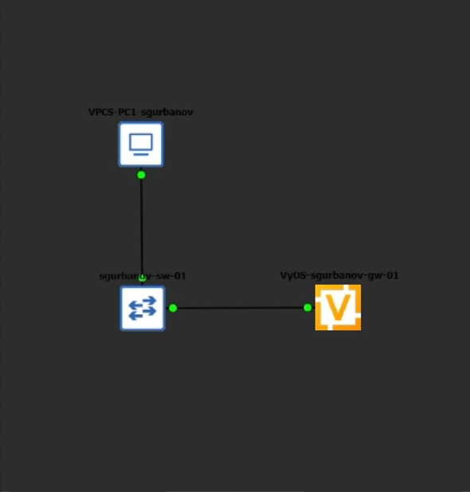{height="455px"}

:::
:::

## Адресация и пул DHCPv4

| Параметр | Значение |
| --- | --- |
| Интерфейс `eth0` | `10.0.0.1/24` |
| Подсеть | `10.0.0.0/24` |
| Диапазон выдачи | `10.0.0.2–10.0.0.253` |
| Шлюз и DNS | `10.0.0.1` |
| Домен | `sgurbanov.net` |

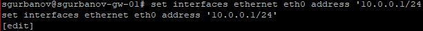{width="88%"}

## Конфигурация DHCPv4

::: {.columns}
::: {.column width="46%"}

- Разделяемая сеть `sgurbanov` использует `subnet-id 1`.
- Границы пула заданы в `range 0`.
- `commit` применяет конфигурацию, `save` записывает её на диск.

:::
::: {.column width="54%"}

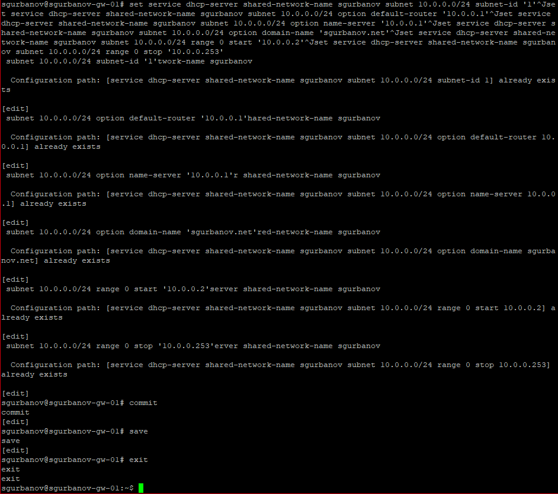{height="460px"}

:::
:::

## Получение адреса на VPCS

::: {.columns}
::: {.column width="57%"}

```text
ip dhcp -d
save
```

| Сообщение | Действие |
| --- | --- |
| Discover | Клиент ищет сервер |
| Offer | Сервер предлагает `10.0.0.2` |
| Request | Клиент запрашивает `10.0.0.2` |
| ACK | Сервер подтверждает аренду |

:::
::: {.column width="43%"}

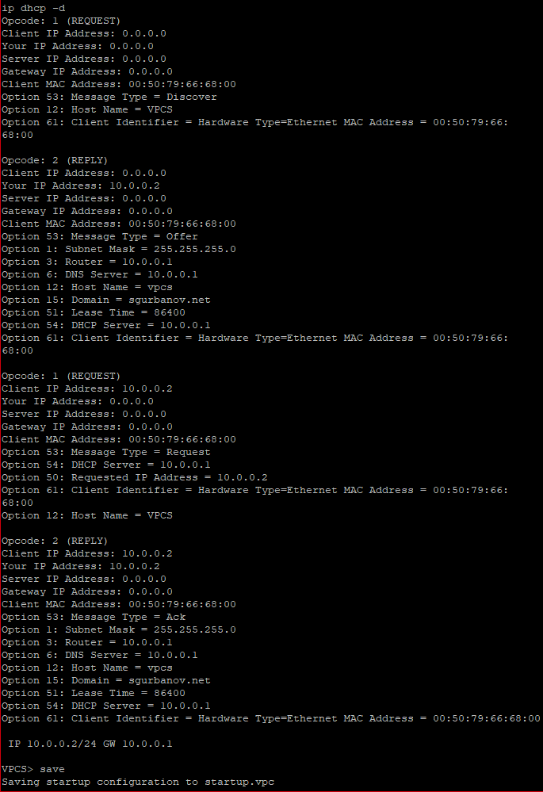{height="470px"}

:::
:::

## Проверка IPv4 на PC1

::: {.columns}
::: {.column width="50%"}

```text
show ip
ping 10.0.0.1 -c 2
```

- VPCS получил `10.0.0.2/24` и аренду на 24 часа.
- Клиент получил `10.0.0.1` как адрес шлюза и DNS-сервера.
- Шлюз ответил на оба ICMP-запроса.

:::
::: {.column width="50%"}

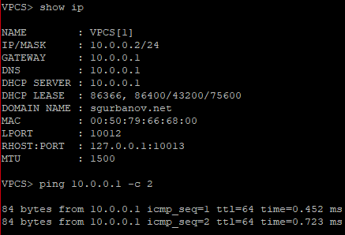{width="96%"}

:::
:::

## Статистика и аренда DHCPv4

| Показатель | До запроса | После выдачи |
| --- | ---: | ---: |
| Активные аренды | 0 | 1 |
| Свободные адреса | 252 | 251 |

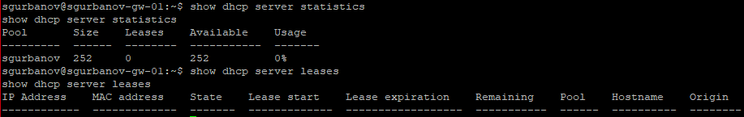{height="90px"}

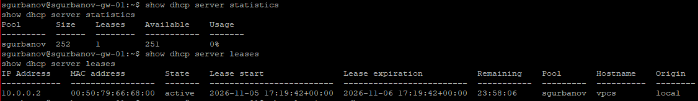{height="108px"}

## Журнал службы DHCPv4

```text
show log | grep dhcp
```

После настройки адреса `eth0` в журнале появилась запись `DHCP4_STARTING` о запуске сервера Kea DHCPv4.

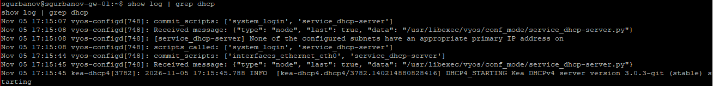{width="100%"}

# Настройка DHCP в случае IPv6

## Топология с двумя сегментами IPv6

::: {.columns}
::: {.column width="45%"}

- `eth1` соединяет VyOS с `sgurbanov-sw-02` и клиентами PC2.
- `eth2` соединяет VyOS с `sgurbanov-sw-03` и клиентами PC3.
- В каждом сегменте есть AlmaLinux и Alpine Linux Virt.

:::
::: {.column width="55%"}

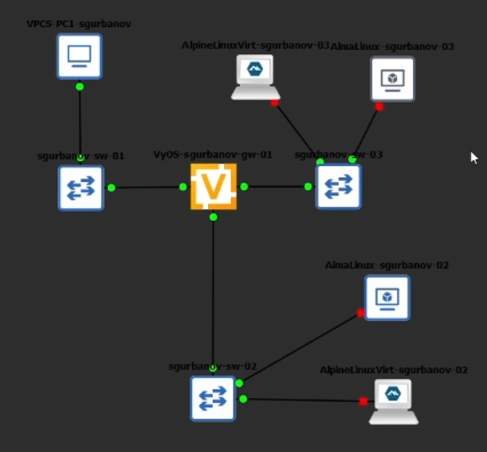{height="455px"}

:::
:::

## IPv6-адреса на VyOS

::: {.columns}
::: {.column width="49%"}

| Интерфейс | IPv6-адрес |
| --- | --- |
| `eth1` | `2000::1/64` |
| `eth2` | `2001::1/64` |

```text
show interfaces
```

:::
::: {.column width="51%"}

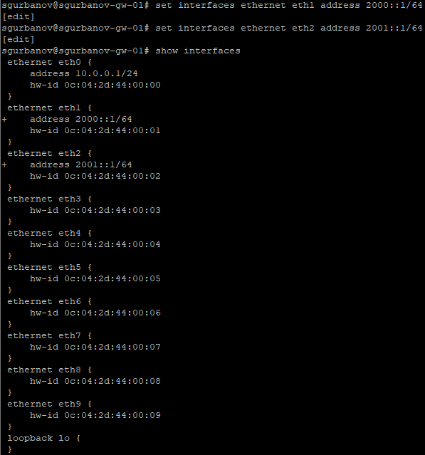{height="460px"}

:::
:::

## DHCPv6 без отслеживания состояния

Для сети `sgurbanov-stateless` заданы префикс `2000::/64`, DNS `2000::1` и домен поиска `sgurbanov.net`.

Клиент формирует IPv6-адрес через SLAAC по префиксу из RA. DHCPv6 в этом режиме передаёт дополнительные параметры.

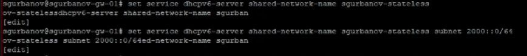{width="86%"}

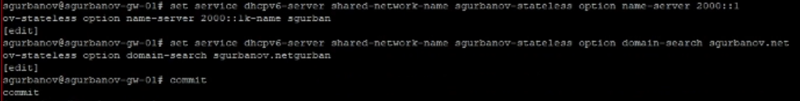{width="86%"}

## Проверка сети на AlmaLinux

::: {.columns}
::: {.column width="45%"}

- На `eth0` появился адрес `2000::e14:d9ff:fe23:0/64`.
- Маршрут по умолчанию получен из RA (`proto ra`).
- На оба запроса к `2000::1` получены ответы.
- В `/etc/resolv.conf` остался комментарий NetworkManager.

:::
::: {.column width="55%"}

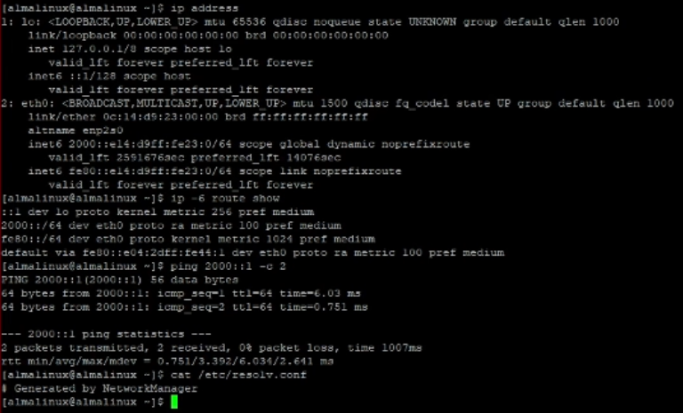{width="98%"}

:::
:::

## Аренды DHCPv6 stateless

```text
run show dhcpv6 server leases
```

Таблица пуста. SLAAC формирует адрес на клиенте без аренды у DHCPv6-сервера.

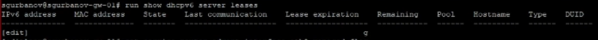{width="100%"}

## DHCPv6 с отслеживанием состояния

- В сети `sgurbanov-stateful` для подсети `2001::/64` указаны `subnet-id 2` и DNS `2001::1`.
- Изменения применены и сохранены командами `commit` и `save`.

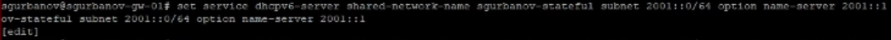{width="96%"}

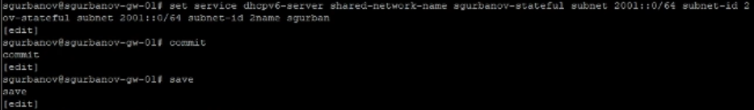{width="86%"}

## Аренды DHCPv6 stateful

```text
run show dhcpv6 server leases
```

На момент проверки таблица аренд пуста.

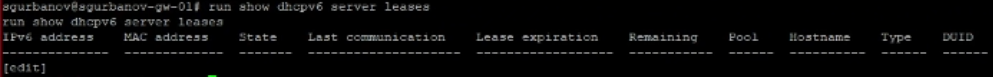{width="100%"}

## Адрес и маршруты Alpine Linux

::: {.columns}
::: {.column width="49%"}

- На `eth0` виден локальный IPv6-адрес из `fe80::/64`.
- Маршрут по умолчанию идёт через локальный адрес VyOS.
- Клиент `udhcpc6` отклонил ключ `-e`. Для выбора интерфейса в справке указан `-i`.

:::
::: {.column width="51%"}

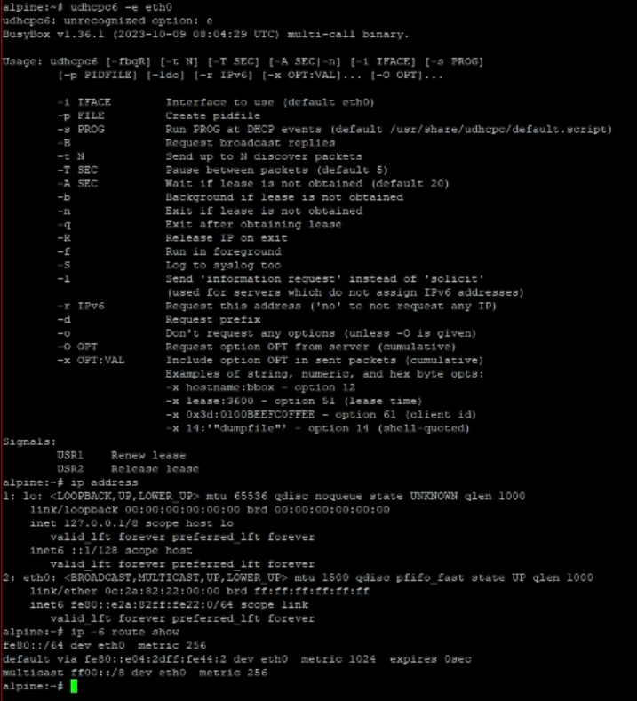{height="460px"}

:::
:::

## Связь и DNS на Alpine Linux

```text
ping 2001::1 -c 2
cat /etc/resolv.conf
```

- VyOS ответил на оба ICMPv6-запроса к `2001::1`.
- В `/etc/resolv.conf` указан DNS-сервер `10.0.2.3`.

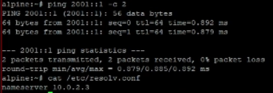{width="57%"}

# Заключение

## Вывод

- DHCPv4 выдал VPCS адрес `10.0.0.2/24`. VyOS зарегистрировал активную аренду.
- AlmaLinux получил IPv6-адрес через SLAAC и маршрут по умолчанию через RA.
- VPCS, AlmaLinux и Alpine Linux получили по два ответа от VyOS. Потерь в этих проверках не было.

::: {.notes}
Королькова А. В., Кулябов Д. С. Сетевые технологии. Лабораторный практикум. Лабораторная работа № 5 «Адресация IPv4 и IPv6. Настройка DHCP». С. 49–58.
:::
