---
## Author
author:
  name: Гурбанов Сарча
  degrees: DSc
  orcid: 0000-0002-0877-7063
  email: 1032244850@rudn.ru
  affiliation:
    - name: Российский университет дружбы народов
      country: Российская Федерация
      postal-code: 117198
      city: Москва
      address: ул. Миклухо-Маклая, д. 6
---

# Отчёт по лабораторной работе № 5

## Адресация IPv4 и IPv6. Настройка DHCP

**Российский университет дружбы народов им. П. Лумумбы**

**Дисциплина:** Сетевые технологии  
**Выполнил:** Гурбанов Сарча  
**Электронная почта:** 1032244850@rudn.ru  
**Место и год:** Москва, 2026

## 1. Цель работы

Получить навыки настройки службы DHCP на сетевом оборудовании для автоматического распределения адресов IPv4 и IPv6.

## 2. Задание

1. Создать в GNS3 сеть с маршрутизатором VyOS, коммутатором и клиентом VPCS.
2. Настроить DHCPv4 для сети `10.0.0.0/24` с диапазоном выдаваемых адресов `10.0.0.2–10.0.0.253`, шлюзом и DNS-сервером `10.0.0.1`.
3. Получить адрес на клиенте, проверить его параметры, доступность шлюза, статистику и аренды DHCP-сервера.
4. Дополнить топологию клиентами AlmaLinux и Alpine Linux для работы с IPv6.
5. Настроить интерфейсы `eth1` и `eth2` маршрутизатора для сетей `2000::/64` и `2001::/64`, а также параметры DHCPv6 без отслеживания состояния и с отслеживанием состояния.
6. Проверить адресацию, маршруты, доступность маршрутизатора и сведения о DNS на клиентах.

## 3. Краткие теоретические сведения

DHCP позволяет автоматически передавать клиенту IP-адрес, маску подсети, адрес шлюза, адреса DNS-серверов и другие параметры. IPv4-адрес предоставляется на ограниченный срок, называемый временем аренды.

Первичное получение адреса DHCPv4 включает четыре сообщения: **Discover**, **Offer**, **Request** и **ACK**. Клиент обнаруживает сервер, получает предложение, запрашивает предложенный адрес и получает подтверждение аренды.

При использовании IPv6 автоматическая настройка может выполняться с помощью SLAAC и DHCPv6. В режиме **stateless** адрес формируется с помощью SLAAC, а DHCPv6 передаёт дополнительные параметры, например DNS. В режиме **stateful** DHCPv6-сервер также распределяет адреса и учитывает аренды. Объявления маршрутизатора RA используются для обнаружения шлюза по умолчанию. Флаг `O` в RA указывает на возможность получения дополнительных параметров через DHCPv6, а флаг `M` - на получение адресов через DHCPv6.

## 4. Выполнение лабораторной работы

### 4.1. Создание топологии IPv4

В GNS3 была собрана сеть из маршрутизатора VyOS, коммутатора `sgurbanov-sw-01` и клиента VPCS. Клиент подключён к коммутатору, а коммутатор - к интерфейсу `eth0` маршрутизатора. На схеме соединения устройств находятся в активном состоянии.

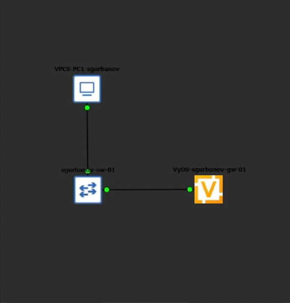

Маршрутизатор настроен под именем `sgurbanov-gw-01`. Дальнейшие команды выполнялись пользователем `sgurbanov`.

### 4.2. План IPv4-адресации

| Устройство или параметр | Значение |
| --- | --- |
| VyOS, интерфейс `eth0` | `10.0.0.1/24` |
| Подсеть клиентов | `10.0.0.0/24` |
| Диапазон DHCP | `10.0.0.2–10.0.0.253` |
| Маска подсети | `255.255.255.0` |
| Шлюз по умолчанию | `10.0.0.1` |
| DNS-сервер, передаваемый клиенту | `10.0.0.1` |
| Домен, передаваемый клиенту | `sgurbanov.net` |

Интерфейсу `eth0` был назначен IPv4-адрес:

```text
set interfaces ethernet eth0 address '10.0.0.1/24'
```

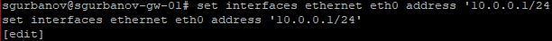

### 4.3. Настройка DHCPv4 на VyOS

Для распределения адресов создана разделяемая сеть `sgurbanov`. В используемой версии VyOS параметры шлюза, DNS и домена задаются в узле `option` соответствующей подсети, а диапазон имеет номер `0`.

```text
set service dhcp-server shared-network-name sgurbanov subnet 10.0.0.0/24 subnet-id '1'
set service dhcp-server shared-network-name sgurbanov subnet 10.0.0.0/24 option default-router '10.0.0.1'
set service dhcp-server shared-network-name sgurbanov subnet 10.0.0.0/24 option name-server '10.0.0.1'
set service dhcp-server shared-network-name sgurbanov subnet 10.0.0.0/24 option domain-name 'sgurbanov.net'
set service dhcp-server shared-network-name sgurbanov subnet 10.0.0.0/24 range 0 start '10.0.0.2'
set service dhcp-server shared-network-name sgurbanov subnet 10.0.0.0/24 range 0 stop '10.0.0.253'
commit
save
exit
```

На снимке при повторном вводе параметров выводятся сообщения `already exists`: указанные значения уже присутствуют в конфигурации. В завершение выполнены команды `commit` и `save` для применения и сохранения настроек.

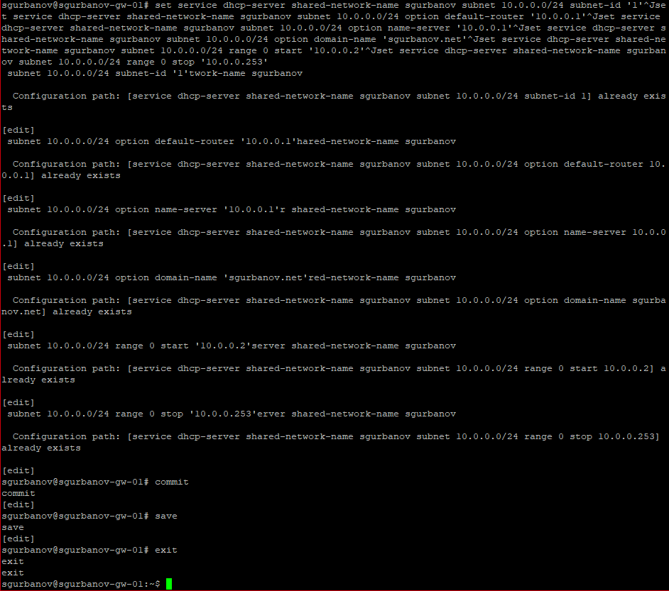

Диапазон содержит 252 адреса. Адрес маршрутизатора `10.0.0.1` в него не входит.

### 4.4. Проверка DHCP-сервера до подключения клиента

Для просмотра состояния сервера использовались команды:

```text
show dhcp server statistics
show dhcp server leases
```

До запроса клиента статистика показывает пул `sgurbanov` размером 252 адреса, отсутствие аренд и 252 свободных адреса. Таблица аренд содержит только заголовки.

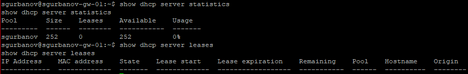

### 4.5. Получение IPv4-адреса и разбор DHCP-обмена

На клиенте VPCS выполнены команды:

```text
ip dhcp -d
save
```

Параметр `-d` включает вывод декодированных сообщений DHCP. Команда `save` сохраняет настройки VPCS в файл `startup.vpc`.

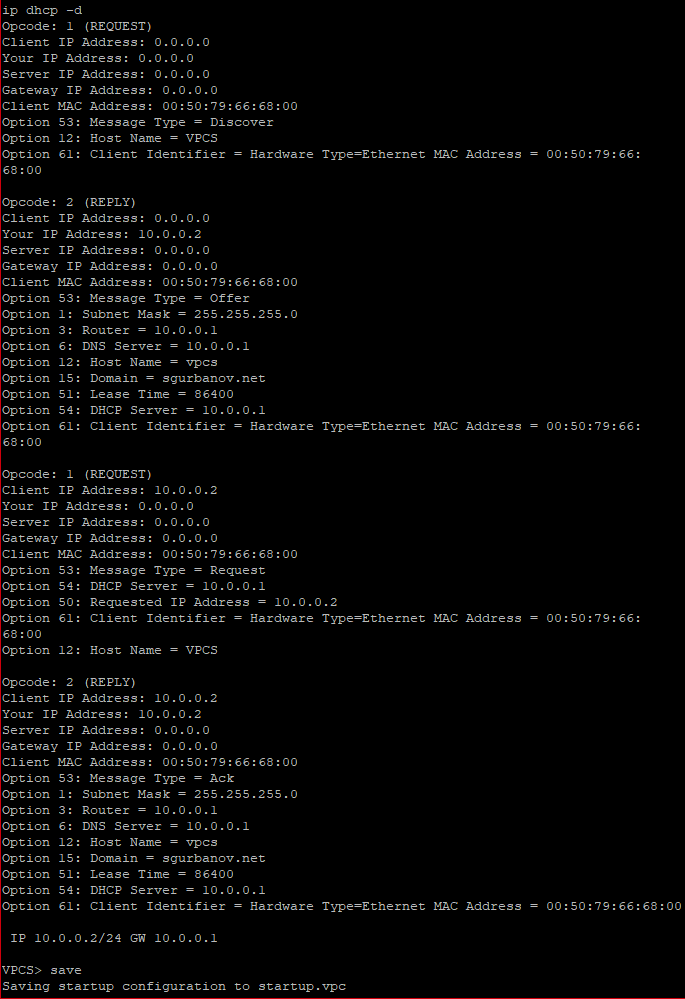

В консольном выводе зафиксирована следующая последовательность:

| Этап | Сообщение | Содержание |
| --- | --- | --- |
| 1 | DHCP Discover | Клиент с MAC-адресом `00:50:79:66:68:00` ищет DHCP-сервер; собственный IPv4-адрес ещё не назначен |
| 2 | DHCP Offer | Сервер `10.0.0.1` предлагает адрес `10.0.0.2` и сетевые параметры |
| 3 | DHCP Request | Клиент запрашивает `10.0.0.2`, указывая выбранный сервер `10.0.0.1` |
| 4 | DHCP ACK | Сервер подтверждает аренду и передаёт параметры конфигурации |

Поле `Opcode` различает запросы клиента (`1`, REQUEST) и ответы сервера (`2`, REPLY). Конкретный тип сообщения DHCP определяется опцией 53.

В сообщениях Offer и ACK показаны основные опции:

| Опция | Назначение | Полученное значение |
| --- | --- | --- |
| 1 | Маска подсети | `255.255.255.0` |
| 3 | Маршрутизатор по умолчанию | `10.0.0.1` |
| 6 | DNS-сервер | `10.0.0.1` |
| 15 | Доменное имя | `sgurbanov.net` |
| 51 | Время аренды | `86400` секунд, то есть 24 часа |
| 54 | Идентификатор DHCP-сервера | `10.0.0.1` |

Итоговая строка `IP 10.0.0.2/24 GW 10.0.0.1` подтверждает получение клиентом адреса и шлюза.

### 4.6. Проверка параметров VPCS и связи со шлюзом

На клиенте выполнены команды:

```text
show ip
ping 10.0.0.1 -c 2
```

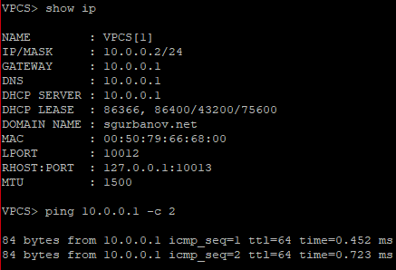

Команда `show ip` показывает:

| Параметр | Значение |
| --- | --- |
| IPv4-адрес и длина префикса | `10.0.0.2/24` |
| Шлюз | `10.0.0.1` |
| DNS-сервер | `10.0.0.1` |
| DHCP-сервер | `10.0.0.1` |
| Домен | `sgurbanov.net` |
| MAC-адрес клиента | `00:50:79:66:68:00` |
| MTU | `1500` |

В строке аренды указаны общий срок `86400` секунд и таймеры `43200` и `75600` секунд. Они соответствуют моментам обновления аренды и перехода к повторному связыванию с сервером.

На оба ICMP-запроса к `10.0.0.1` получены ответы. Время ответа составило `0.452` и `0.723` мс, потерь среди двух запросов нет. Это подтверждает доступность шлюза из клиентского сегмента.

### 4.7. Проверка статистики, аренды и журнала DHCPv4

После получения адреса на маршрутизаторе повторно просмотрены статистика и таблица аренд.

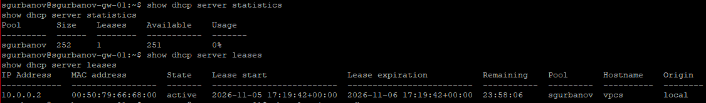

| Показатель | До запроса клиента | После получения адреса |
| --- | --- | --- |
| Размер пула | 252 | 252 |
| Число аренд | 0 | 1 |
| Свободные адреса | 252 | 251 |

В таблице аренд присутствует адрес `10.0.0.2`, связанный с MAC-адресом `00:50:79:66:68:00`. Состояние аренды - `active`, пул - `sgurbanov`, имя клиента - `vpcs`. Разница между временем начала и окончания аренды составляет сутки.

В колонке `Usage` показано `0%`, хотя одна аренда уже существует: доля занятых адресов равна примерно `0,4%`, а в выводе отображается целое значение процентов.

Для просмотра сообщений службы выполнена команда:

```text
show log | grep dhcp
```

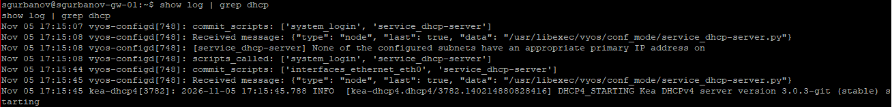

В журнале видны записи о применении конфигурации и запуске службы `kea-dhcp4`. Сообщение `DHCP4_STARTING` фиксирует запуск сервера Kea DHCPv4. Более раннее сообщение об отсутствии подходящего основного адреса интерфейса относится к этапу подготовки: далее в журнале отображаются изменение `interfaces_ethernet_eth0` и запуск службы, а её работоспособность подтверждается выданной клиенту арендой.

### 4.8. Расширение топологии для IPv6

В проект добавлены ещё два коммутатора и клиенты AlmaLinux и Alpine Linux Virt. Один сегмент предназначен для сети `2000::/64`, второй - для `2001::/64`. Исходный сегмент IPv4 сохранён.

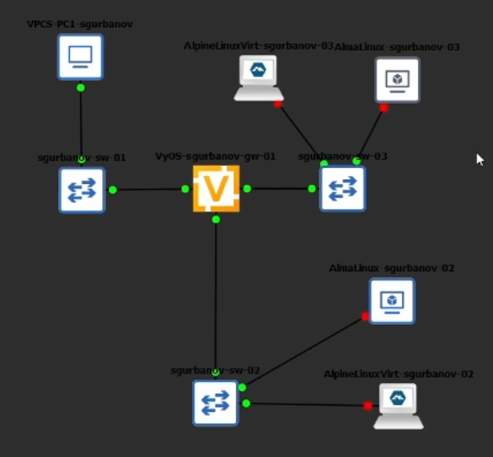

План адресации IPv6 по заданию:

| Устройство или сегмент | Интерфейс | Адрес или способ настройки |
| --- | --- | --- |
| VyOS, сегмент PC2 | `eth1` | `2000::1/64` |
| Клиенты PC2 | `eth0` | SLAAC; дополнительные параметры через DHCPv6 stateless |
| VyOS, сегмент PC3 | `eth2` | `2001::1/64` |
| Клиенты PC3 | `eth0` | Получение адреса через DHCPv6 stateful |
| Планируемый пул DHCPv6 stateful | - | `2001::100–2001::199` |

### 4.9. Назначение IPv6-адресов интерфейсам VyOS

На маршрутизаторе введены команды:

```text
set interfaces ethernet eth1 address 2000::1/64
set interfaces ethernet eth2 address 2001::1/64
show interfaces
```

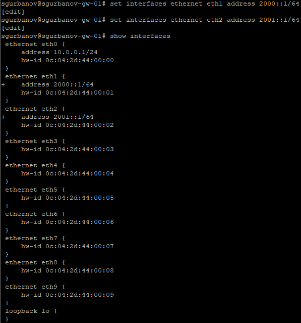

В выводе конфигурации для `eth0` сохраняется адрес `10.0.0.1/24`, для `eth1` указан `2000::1/64`, для `eth2` - `2001::1/64`. Маршрутизатор объединяет три клиентских сегмента.

### 4.10. Параметры DHCPv6 без отслеживания состояния

На VyOS создана разделяемая сеть `sgurbanov-stateless` и указан префикс `2000::/64`:

```text
set service dhcpv6-server shared-network-name sgurbanov-stateless
set service dhcpv6-server shared-network-name sgurbanov-stateless subnet 2000::0/64
```

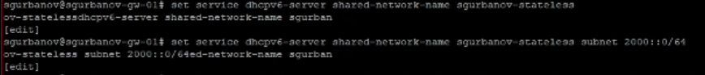

Для этой сети заданы адрес DNS-сервера и домен поиска:

```text
set service dhcpv6-server shared-network-name sgurbanov-stateless option name-server 2000::1
set service dhcpv6-server shared-network-name sgurbanov-stateless option domain-search sgurbanov.net
commit
```

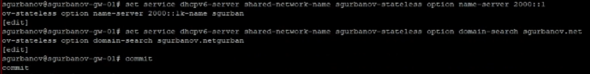

Эти параметры предназначены для передачи клиенту сведений о DNS и домене поиска. В режиме stateless сам IPv6-адрес формируется посредством SLAAC.

На клиенте AlmaLinux выполнены проверки:

```text
ip address
ip -6 route show
ping 2000::1 -c 2
cat /etc/resolv.conf
```

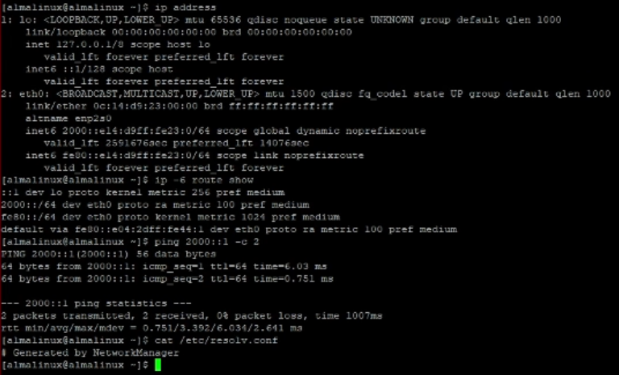

Интерфейс `eth0` находится в состоянии `UP` и имеет глобальный динамический адрес `2000::e14:d9ff:fe23:0/64`, а также локальный адрес канала. В таблице маршрутизации присутствуют маршрут в сеть `2000::/64` и маршрут по умолчанию через link-local-адрес маршрутизатора. Пометка `proto ra` указывает, что соответствующие маршруты получены из объявлений RA.

На оба запроса `ping 2000::1 -c 2` получены ответы; потери составляют `0%`. Таким образом, автоматическая адресация AlmaLinux и связь с маршрутизатором в сегменте `2000::/64` подтверждены. В `/etc/resolv.conf` на этом снимке содержится только комментарий `Generated by NetworkManager`; строки `nameserver` не показаны.

На маршрутизаторе просмотрена таблица аренд:

```text
run show dhcpv6 server leases
```

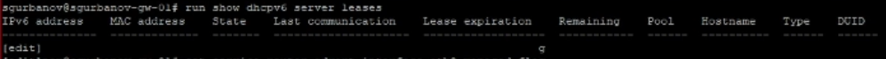

Таблица не содержит записей. Для адресов, сформированных посредством SLAAC, отсутствие аренд DHCPv6 ожидаемо: сервер не выделяет эти адреса. Сам по себе пустой список аренд не подтверждает получение клиентом дополнительных параметров DNS.

### 4.11. Параметры DHCPv6 с отслеживанием состояния

Для сети `sgurbanov-stateful` на снимках зафиксированы настройка DNS-сервера `2001::1` в подсети `2001::/64` и назначение этой подсети идентификатора `2`:

```text
set service dhcpv6-server shared-network-name sgurbanov-stateful subnet 2001::0/64 option name-server 2001::1
set service dhcpv6-server shared-network-name sgurbanov-stateful subnet 2001::0/64 subnet-id 2
commit
save
```

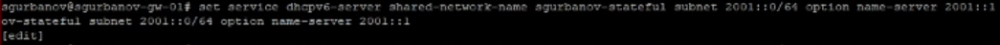

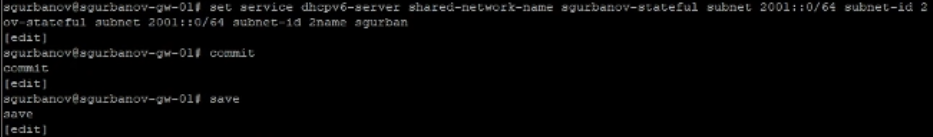

После сохранения повторно выполнена команда просмотра аренд:

```text
run show dhcpv6 server leases
```

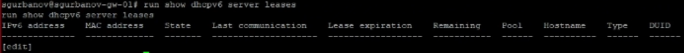

На момент проверки в таблице нет записей о выданных IPv6-адресах.

### 4.12. Проверка IPv6 на Alpine Linux

На Alpine Linux предпринят запуск клиента DHCPv6, затем просмотрены адреса и маршруты.

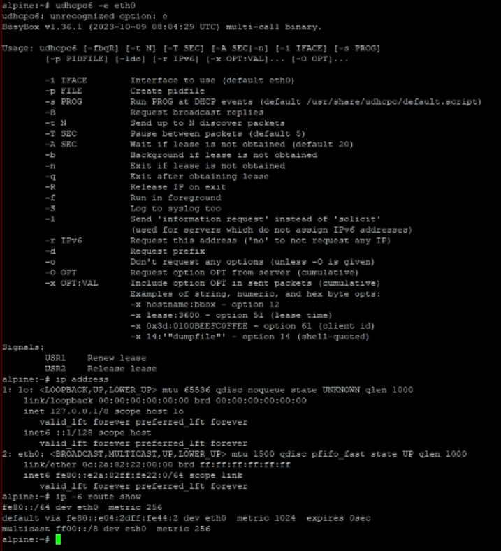

На снимке команда `udhcpc6 -e eth0` завершилась сообщением `unrecognized option: e` и выводом справки. Поэтому этот запуск не подтверждает получение аренды. В справке для выбора интерфейса указан параметр `-i`; в задании используется команда `udhcpc6 -i eth0`.

В показанном выводе `ip address` у интерфейса `eth0` присутствует локальный IPv6-адрес канала, а в таблице маршрутизации - маршрут по умолчанию через link-local-адрес маршрутизатора.

Далее выполнены команды проверки связи и просмотра DNS:

```text
ping 2001::1 -c 2
cat /etc/resolv.conf
```

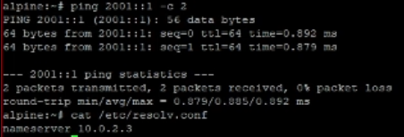

Оба ICMP-запроса к `2001::1` получили ответы. Потери составили `0%`, минимальное и максимальное время ответа - `0.879` и `0.892` мс. Проверка подтверждает доступность интерфейса маршрутизатора из этого сегмента.

В `/etc/resolv.conf` указан `nameserver 10.0.2.3`. Адрес `2001::1`, заданный в параметрах DHCPv6, в этом выводе не отображается. Успешный `ping` подтверждает связь с маршрутизатором, но не является подтверждением выдачи IPv6-адреса из пула DHCPv6.

### 4.13. Результаты проверки связности

| Клиент | Проверяемый адрес | Отправлено | Получено | Потери |
| --- | --- | --- | --- | --- |
| VPCS | `10.0.0.1` | 2 | 2 | `0%` |
| AlmaLinux | `2000::1` | 2 | 2 | `0%` |
| Alpine Linux | `2001::1` | 2 | 2 | `0%` |

## 5. Выводы

В ходе лабораторной работы в GNS3 собрана топология с одним сегментом IPv4 и двумя сегментами IPv6. На маршрутизаторе VyOS настроен DHCPv4 для сети `10.0.0.0/24` с пулом `10.0.0.2–10.0.0.253`.

Клиент VPCS автоматически получил адрес `10.0.0.2/24`, шлюз и адрес DNS-сервера `10.0.0.1`, а также домен `sgurbanov.net`. По декодированному выводу клиента разобраны четыре этапа DHCP-обмена. Статистика маршрутизатора подтвердила одну активную аренду и 251 свободный адрес.

В части IPv6 интерфейсам VyOS назначены адреса `2000::1/64` и `2001::1/64`, заданы параметры сетей DHCPv6 stateless и stateful. На AlmaLinux подтверждены автоматическое получение глобального адреса и маршрутов через RA. Проверки доступности маршрутизатора с VPCS, AlmaLinux и Alpine Linux завершились без потерь пакетов. Выдача адреса из пула DHCPv6 в представленных результатах не зафиксирована.

## 6. Источники

1. Королькова А. В., Кулябов Д. С. Сетевые технологии. Лабораторный практикум. Лабораторная работа № 5 «Адресация IPv4 и IPv6. Настройка DHCP». С. 49–58.
2. Снимки экрана выполнения лабораторной работы в GNS3, VyOS, VPCS, AlmaLinux и Alpine Linux из предоставленного архива `images.rar`.