---
## Author
author:
  name: Гурбанов Сарча
  degrees: DSc
  orcid: 0000-0002-0877-7063
  email: 1032244850@rudn.ru
  affiliation:
    - name: Российский университет дружбы народов
      country: Российская Федерация
      postal-code: 117198
      city: Москва
      address: ул. Миклухо-Маклая, д. 6
## Title
title: Научная презентация
subtitle: Структура и оформление
license: CC BY
date: today
date-format: "YYYY-MM-DD" # Example: 2025-09-06
---

# Вводная часть

## Цель и задачи

**Цель:** изучить маршрутизацию RIP в сетях IPv4 и IPv6 и настройку сетевого оборудования.

- Настроить адресацию IPv4 и IPv6.
- Включить RIPv2 и RIPng на маршрутизаторах.
- Проверить маршруты и доступность PC2.
- Исследовать отключение и включение интерфейса.

::: notes

Работа выполнена в GNS3 на маршрутизаторах FRR и узлах VPCS. Для проверки используются команды просмотра конфигурации, таблиц маршрутизации, ping и trace.

Источник: задание к лабораторной работе № 6, разделы 6.1 и 6.3.1, страницы 59–69. Подробное описание этапов приведено в отчёте nettech-lab06-report.md.

:::

## Топология сети

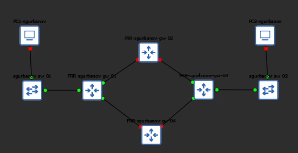{width=840 fig-alt="Четыре маршрутизатора FRR соединены в кольцо. PC1 подключён к gw-01, PC2 к gw-03 через коммутаторы."}

Два пути между gw-01 и gw-03: через gw-02 или gw-04.

::: notes

В сети четыре маршрутизатора, два коммутатора и два оконечных узла. PC1 находится в сети gw-01, а PC2 в сети gw-03. На слайдах используются сокращённые обозначения устройств из задания.

Источник изображения: снимок 1 из приложенного архива images(3).rar. Адресный план задан в таблицах 6.1 и 6.2 методических указаний.

:::

## Адреса оконечных узлов

| Узел | IPv4 | IPv6 | Шлюз IPv4 |
| --- | --- | --- | --- |
| PC1 | 10.0.10.10/24 | 2001:10::a/64 | 10.0.10.1 |
| PC2 | 10.0.11.10/24 | 2001:11::a/64 | 10.0.11.1 |

- PC1 подключён к gw-01 через sw-01.
- PC2 подключён к gw-03 через sw-02.
- На gw-01 и gw-03 включены объявления IPv6 Router Advertisement.

::: notes

Адреса оконечных узлов назначены вручную. Для IPv4 используются маски /24, для IPv6 префиксы /64. В исходной таблице задания шлюз IPv6 явно не задан. Объявления маршрутизаторов включены на интерфейсах, обращённых к локальным сетям.

Источники: таблица 6.2 задания, снимки 2, 3, 12–14 и 19, разделы отчёта о настройке адресации.

:::

## Адреса транзитных сетей

| Соединение | Сеть IPv4 | Сеть IPv6 |
| --- | --- | --- |
| gw-01 / gw-02 | 10.0.1.0/24 | 2001:1::/64 |
| gw-02 / gw-03 | 10.0.2.0/24 | 2001:2::/64 |
| gw-03 / gw-04 | 10.0.3.0/24 | 2001:3::/64 |
| gw-04 / gw-01 | 10.0.4.0/24 | 2001:4::/64 |

Каждое соединение маршрутизаторов использует отдельные подсети IPv4 и IPv6.

::: notes

Таблица воспроизводит транзитные сегменты адресного плана. Полная адресация отдельных интерфейсов находится в отчёте.

Источник: таблица 6.1 задания, страница 60, и раздел «Документирование моделируемой сети» отчёта.

:::

# Выполнение работы

## Адресация PC1

:::::::::::::: {.columns align=center}
::: {.column width="50%"}

**IPv4**

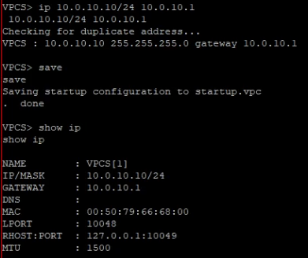{height=410}

:::
::: {.column width="50%"}

**IPv6**

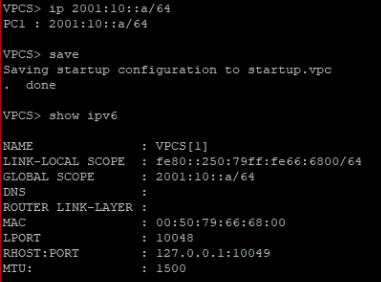{height=410}

:::
::::::::::::::

::: notes

PC1 получил статические адреса 10.0.10.10/24 и 2001:10::a/64. Команды save, show ip и show ipv6 подтверждают сохранение и проверку настроек. Помимо глобального IPv6-адреса, на интерфейсе присутствует локальный для канала адрес fe80::250:79ff:fe66:6800/64.

PC2 настроен аналогично с адресами 10.0.11.10/24 и 2001:11::a/64.

Источники изображений: снимки 2 и 12. Дополнительные результаты для PC2: снимки 3 и 13, разделы отчёта о настройке оконечных узлов.

:::

## Двойной стек на маршрутизаторах

Пример настройки интерфейса eth0 на gw-01:

```text
interface eth0
 ip address 10.0.10.1/24
 ipv6 address 2001:10::1/64
 ipv6 nd prefix 2001:10::/64
 no ipv6 nd suppress-ra
 no shutdown
```

- `ipv6 forwarding` включает пересылку IPv6.
- `write memory` сохраняет конфигурацию.

::: notes

Фрагмент объединяет настройку IPv4 и IPv6 одного интерфейса. Команда ipv6 forwarding выполняется в глобальном режиме конфигурации, write memory в привилегированном режиме. На остальных интерфейсах назначены адреса соответствующих транзитных сетей. На eth0 gw-03 аналогично включены объявления префикса 2001:11::/64.

Источники: снимки 4, 14–16 и 19–23, раздел «Настройка адресации IPv6» отчёта.

:::

## Настройка RIPv2

:::::::::::::: {.columns align=center}
::: {.column width="50%"}

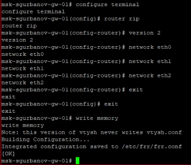{height=450}

:::
::: {.column width="50%"}

- `router rip` включает процесс RIP.
- `version 2` задаёт RIPv2.
- `network ethX` выбирает интерфейсы.

На gw-01 и gw-03 используются eth0–eth2, на gw-02 и gw-04 используются eth0 и eth1.

:::
::::::::::::::

::: notes

Протокол настроен на всех четырёх маршрутизаторах. Для gw-01 на снимке показаны включение версии 2, выбор трёх интерфейсов и сохранение конфигурации. Остальные маршрутизаторы настроены по тому же принципу.

Источник изображения: снимок 24. Дополнительные источники: снимки 25–27, раздел «Настройка динамической маршрутизации RIPv2» отчёта.

:::

## Таблица маршрутов IPv4

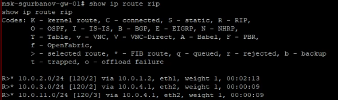{width=1000}

- gw-01 получил маршруты к трём удалённым сетям.
- Маршрут к сети PC2 `10.0.11.0/24` ведёт через `10.0.4.1`.
- Запись `[120/3]` содержит дистанцию 120 и метрику 3.

::: notes

Маршрут к 10.0.2.0/24 направлен через 10.0.1.2 и eth1 с метрикой 2. Маршрут к 10.0.3.0/24 направлен через 10.0.4.1 и eth2 с метрикой 2. Сеть PC2 имеет следующий узел 10.0.4.1, интерфейс eth2 и метрику 3.

Статус RIP показывает базовый период обновлений 30 секунд, timeout 180 секунд и garbage collect 120 секунд. Эти значения являются таймерами протокола, а не измеренным временем восстановления связи.

Источник изображения: снимок 28. Параметры RIP: снимки 29–30 и соответствующий раздел отчёта.

:::

## Проверка связности IPv4

:::::::::::::: {.columns align=center}
::: {.column width="34%"}

**Ping к PC2**

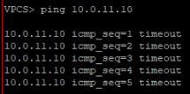{width=360}

:::
::: {.column width="66%"}

**Трассировка**

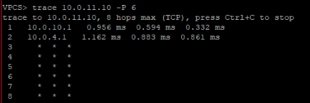{width=730}

:::
::::::::::::::

PC2 не отвечает. Трассировка получает ответы от gw-01 и gw-04, затем показывает тайм-ауты.

::: notes

Команда ping 10.0.11.10 дала пять тайм-аутов. Команда trace 10.0.11.10 -P 6 показала адреса 10.0.10.1 и 10.0.4.1, после которых ответов не было. Наличие маршрута в таблице не подтверждает сквозную доступность узла.

В IPv4-опыте отключался eth0 на gw-02, хотя трассировка уже использовала gw-04. Поэтому этот опыт не подтверждает переключение активного пути к PC2.

Источники изображений: снимки 31 и 32. Отключение и повторные проверки: снимки 33–36, раздел проверки IPv4 в отчёте.

:::

## Конфигурация gw-03

:::::::::::::: {.columns align=center}
::: {.column width="48%"}

Фрагмент `show running-config`:

```text
interface eth0
 ip address 10.0.11.1/24

interface eth1
 ip address 10.0.11.1/24
 ip address 10.0.2.2/24
```

:::
::: {.column width="52%"}

- Адрес `10.0.11.1/24` присутствует на двух интерфейсах.
- По плану eth1 должен использовать `10.0.2.2/24`.
- Причина тайм-аутов требует дополнительной проверки.

:::
::::::::::::::

::: notes

На начальных снимках 8 и 9 eth1 имеет адрес 10.0.11.1/24. В более позднем выводе на снимке 21 присутствует также плановый адрес 10.0.2.2/24, но ошибочная запись остаётся. Это установленное расхождение с адресным планом. По снимкам нельзя утверждать, что оно является единственной причиной недоступности PC2.

В приведённом фрагменте показаны только строки IPv4, остальные строки конфигурации опущены для удобства чтения.

Источник: снимок 21 и анализ конфигурации gw-03 в отчёте.

:::

## Настройка RIPng

:::::::::::::: {.columns align=center}
::: {.column width="52%"}

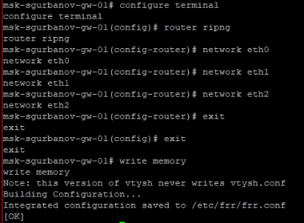{height=440}

:::
::: {.column width="48%"}

- `router ripng` включает протокол для IPv6.
- Интерфейсы задаются командами `network ethX`.
- RIPng настроен на четырёх маршрутизаторах.

Проверка таблицы:

```text
show ipv6 ripng
```

:::
::::::::::::::

::: notes

На gw-01 и gw-03 в RIPng включены eth0, eth1 и eth2, а на gw-02 и gw-04 включены eth0 и eth1. Конфигурации сохранены командой write memory.

Источник изображения: снимок 37. Настройка остальных маршрутизаторов: снимки 38–40 и раздел отчёта о RIPng.

:::

# Результаты

## Связность IPv6

:::::::::::::: {.columns align=center}
::: {.column width="50%"}

**Пять успешных ответов**

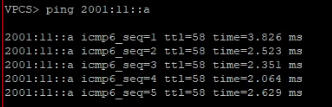{width=550}

:::
::: {.column width="50%"}

**Путь через gw-02**

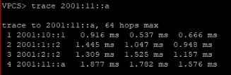{width=550}

:::
::::::::::::::

PC2 отвечает на `ping 2001:11::a`. Задержки в показанной серии составляют 2,064–3,826 мс.

::: notes

Трассировка проходит через 2001:10::1 на gw-01, 2001:1::2 на gw-02, 2001:2::2 на gw-03 и достигает PC2 с адресом 2001:11::a. Все пять запросов ping получают ответы.

Диапазон задержек относится только к представленной серии из пяти запросов.

Источники изображений: снимки 41 и 42, раздел проверки связи IPv6 в отчёте.

:::

## Таблица RIPng

:::::::::::::: {.columns align=center}
::: {.column width="66%"}

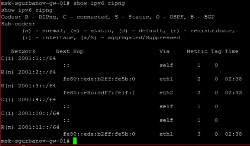{width=755}

:::
::: {.column width="34%"}

Сеть PC2:

`2001:11::/64`

- Интерфейс eth1.
- Следующий узел gw-02.
- Метрика 3.

:::
::::::::::::::

::: notes

Следующий узел для сети PC2 указан локальным для канала адресом fe80::ede:b2ff:fe5b:0. Сеть 2001:2::/64 также изучена через eth1 и имеет метрику 2. Сеть 2001:3::/64 изучена через eth2 с метрикой 2. Непосредственно подключённые сети отмечены как C(i), изученные маршруты как R(n).

Маршрут к PC2 согласуется с направлением успешной трассировки через gw-02.

Источник изображения: снимок 43, раздел «Анализ таблицы RIPng» отчёта.

:::

## Отключение eth0 на gw-02

Команда `shutdown` отключает eth0 на gw-02.

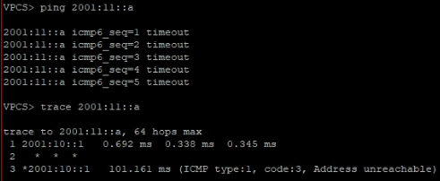{width=880}

PC2 не отвечает. gw-01 сообщает `Address unreachable`.

::: notes

Отключение eth0 на gw-02 показано на снимке 44. Пять запросов ping после отключения завершаются тайм-аутами. При трассировке отвечает gw-01, затем появляется ICMPv6 type 1, code 3, Address unreachable.

В зафиксированный момент альтернативный путь через gw-04 не обеспечил успешную доставку. Эти данные не подтверждают автоматическое переключение на резервный путь и не позволяют оценить время сходимости.

Источник изображения: снимок 46. Дополнительный источник: снимок 44 и раздел отчёта об отключении интерфейса.

:::

## Восстановление соединения

Интерфейс eth0 на gw-02 включён командой `no shutdown`.

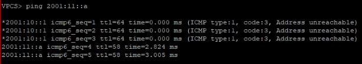{width=1120}

- Запросы № 1–3: сообщение `Address unreachable`.
- Запросы № 4–5: ответы PC2 за 2,824 и 3,005 мс.

::: notes

Команда no shutdown показана на снимке 47. В следующей серии запросов первые три ответа сообщает gw-01 как недоступность адреса. На четвёртый и пятый запросы приходит ответ от конечного узла.

По снимкам установлено восстановление связи в ходе этой серии. Точное время от включения интерфейса до восстановления не измерено. Номер четвёртого запроса нельзя приравнивать к четырём секундам.

Источник изображения: снимок 48. Дополнительный источник: снимок 47 и раздел отчёта о восстановлении связи.

:::

## Маршрут после восстановления

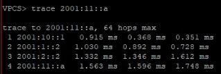{width=960}

Пакеты снова проходят через gw-01, gw-02 и gw-03 и достигают PC2.

::: notes

Повторная трассировка показывает прежнюю последовательность адресов: 2001:10::1, 2001:1::2, 2001:2::2 и 2001:11::a. Это подтверждает восстановление пути через включённый gw-02, а не переключение на gw-04.

Источник изображения: снимок 49, заключительная проверка IPv6 в отчёте.

:::

## Сопоставление результатов

| Проверка | Наблюдение |
| --- | --- |
| RIPv2 | Маршруты к удалённым сетям присутствуют |
| Связность IPv4 | PC2 не отвечает на пять запросов |
| Связность IPv6 | PC2 отвечает через gw-02 |
| Отключение и включение eth0 | Связь пропадает и затем восстанавливается |

::: notes

Сравнение разделяет наличие записей маршрутизации и фактическую доставку пакетов. В IPv4 подтверждён обмен маршрутами, но не сквозная связность. В IPv6 подтверждены и успешная доставка до отключения, и её восстановление после включения интерфейса.

Источники: снимки 28, 31, 41–42, 46, 48–49 и таблица результатов проверок в отчёте.

:::

# Заключение

## Выводы

- Освоена настройка двойного стека и протоколов RIPv2/RIPng в FRR.
- Для IPv4 требуется устранить расхождение адресации gw-03 и повторить проверку связи.
- Для IPv6 подтверждена связь между PC1 и PC2 и её восстановление после включения интерфейса gw-02.

::: notes

Главный результат работы: получен опыт настройки протоколов и проверки реального прохождения пакетов. Отдельно подчеркнуть, что восстановление после no shutdown наблюдалось по прежнему пути через gw-02. Успешное автоматическое переключение на gw-04 в представленном опыте не показано.

