---
## Author
author:
  name: Гурбанов Сарча
  degrees: DSc
  orcid: 0000-0002-0877-7063
  email: 1032244850@rudn.ru
  affiliation:
    - name: Российский университет дружбы народов
      country: Российская Федерация
      postal-code: 117198
      city: Москва
      address: ул. Миклухо-Маклая, д. 6

## Title
title: "Лабораторная работа №6"
subtitle: "Адресация IPv4 и IPv6. Настройка маршрутизации по протоколу RIP"
license: "CC BY"
lang: ru-RU
abstract: |
  В отчёте рассмотрены настройка адресации IPv4 и IPv6 и динамической маршрутизации RIPv2 и RIPng на маршрутизаторах FRR в среде GNS3.

  Приведены таблицы адресации, конфигурации устройств, результаты просмотра таблиц маршрутизации и проверки связи между оконечными узлами.

  Описаны результаты отключения и повторного включения интерфейса маршрутизатора, а также выявленные особенности работы сети.
keywords: [лабораторная работа, сетевые технологии, GNS3, FRR, IPv4, IPv6, RIPv2, RIPng]
---

# Введение

## Цель работы

Изучение принципов маршрутизации по протоколу RIP в IPv4- и IPv6-сетях и принципов настройки сетевого оборудования.

## Задание

- Задокументировать топологию моделируемой сети и адресацию её устройств.
- Настроить адреса IPv4 и IPv6 на оконечных узлах и интерфейсах маршрутизаторов FRR.
- Настроить динамическую маршрутизацию RIPv2 для IPv4 и RIPng для IPv6.
- Изучить таблицы маршрутизации, значения метрик и параметры протокола RIP.
- Проверить доступность удалённого узла и пути прохождения пакетов командами `ping` и `trace`.
- Исследовать состояние сети при отключении и повторном включении интерфейса маршрутизатора.

# Выполнение лабораторной работы

## Документирование моделируемой сети

В среде GNS3 собрана сеть из четырёх маршрутизаторов FRR, двух коммутаторов и двух оконечных узлов VPCS. Маршрутизаторы соединены в кольцо: gw-01, gw-02, gw-03, gw-04. Узел PC1 подключён к gw-01 через sw-01, а PC2 — к gw-03 через sw-02.

Между gw-01 и gw-03 предусмотрены два пути: через gw-02 и через gw-04. В дальнейшем используются сокращённые обозначения устройств `gw-01`–`gw-04`, `sw-01`, `sw-02`, `PC1` и `PC2`, соответствующие устройствам на снимках экрана.

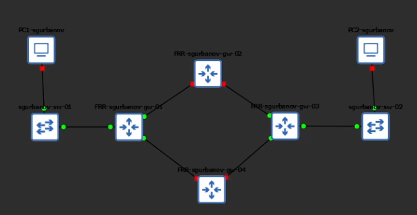

### Таблица адресов сетей

Адресный план воспроизводит таблицу 6.1 задания.

| Сегмент | Сеть IPv4 | Сеть IPv6 |
| --- | --- | --- |
| PC1 — gw-01 | 10.0.10.0/24 | 2001:10::/64 |
| PC2 — gw-03 | 10.0.11.0/24 | 2001:11::/64 |
| gw-01 — gw-02 | 10.0.1.0/24 | 2001:1::/64 |
| gw-02 — gw-03 | 10.0.2.0/24 | 2001:2::/64 |
| gw-03 — gw-04 | 10.0.3.0/24 | 2001:3::/64 |
| gw-04 — gw-01 | 10.0.4.0/24 | 2001:4::/64 |

### Таблица адресации устройств

В таблице объединены строки IPv4 и IPv6 для каждого интерфейса из таблицы 6.2 задания. Это плановые значения; особенности фактической конфигурации gw-03 рассмотрены ниже.

| Устройство | Интерфейс | Адрес IPv4 | Адрес IPv6 | Шлюз по умолчанию IPv4 | Следующее устройство |
| --- | --- | --- | --- | --- | --- |
| gw-01 | eth0 | 10.0.10.1/24 | 2001:10::1/64 | — | PC1 через sw-01 |
| gw-01 | eth1 | 10.0.1.1/24 | 2001:1::1/64 | — | gw-02 |
| gw-01 | eth2 | 10.0.4.2/24 | 2001:4::2/64 | — | gw-04 |
| gw-02 | eth0 | 10.0.1.2/24 | 2001:1::2/64 | — | gw-01 |
| gw-02 | eth1 | 10.0.2.1/24 | 2001:2::1/64 | — | gw-03 |
| gw-03 | eth0 | 10.0.11.1/24 | 2001:11::1/64 | — | PC2 через sw-02 |
| gw-03 | eth1 | 10.0.2.2/24 | 2001:2::2/64 | — | gw-02 |
| gw-03 | eth2 | 10.0.3.1/24 | 2001:3::1/64 | — | gw-04 |
| gw-04 | eth0 | 10.0.3.2/24 | 2001:3::2/64 | — | gw-03 |
| gw-04 | eth1 | 10.0.4.1/24 | 2001:4::1/64 | — | gw-01 |
| PC1 | NIC | 10.0.10.10/24 | 2001:10::a/64 | 10.0.10.1 | gw-01 |
| PC2 | NIC | 10.0.11.10/24 | 2001:11::a/64 | 10.0.11.1 | gw-03 |

В исходной таблице задания шлюз IPv6 не задан. На интерфейсах gw-01 и gw-03, обращённых к оконечным узлам, далее включаются объявления маршрутизатора Router Advertisement.

## Настройка адресации IPv4

### Настройка оконечных узлов

На PC1 назначен адрес `10.0.10.10/24` и шлюз `10.0.10.1`. Конфигурация сохранена и проверена командой `show ip`:

```text
ip 10.0.10.10/24 10.0.10.1
save
show ip
```

Вывод подтверждает заданные адрес и шлюз. Маска `/24` соответствует `255.255.255.0`.

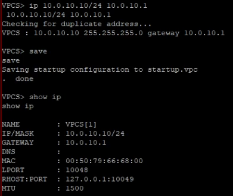

На PC2 назначен адрес `10.0.11.10/24` и шлюз `10.0.11.1`:

```text
ip 10.0.11.10/24 10.0.11.1
save
show ip
```

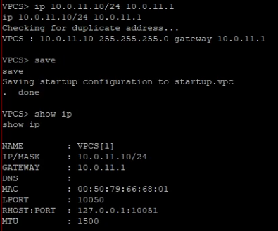

### Настройка маршрутизаторов

Для настройки интерфейсов FRR выполнен переход в режим конфигурирования командой `configure terminal`. Адреса назначены командой `ip address`, интерфейсы включены командой `no shutdown`. Конфигурация сохраняется командой `write memory`, а её содержимое проверяется командой `show running-config`.

На gw-01 настроены интерфейсы eth0, eth1 и eth2:

```text
configure terminal
interface eth0
 ip address 10.0.10.1/24
 no shutdown
 exit
interface eth1
 ip address 10.0.1.1/24
 no shutdown
 exit
interface eth2
 ip address 10.0.4.2/24
 no shutdown
 exit
exit
write memory
show running-config
```

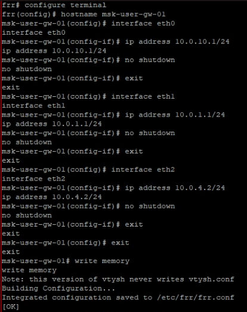

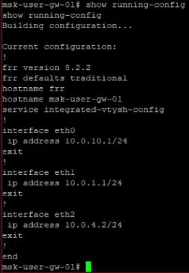

На gw-02 интерфейсу eth0 назначен адрес `10.0.1.2/24`, а eth1 — `10.0.2.1/24`. Эти интерфейсы соединяют маршрутизатор с gw-01 и gw-03 соответственно.

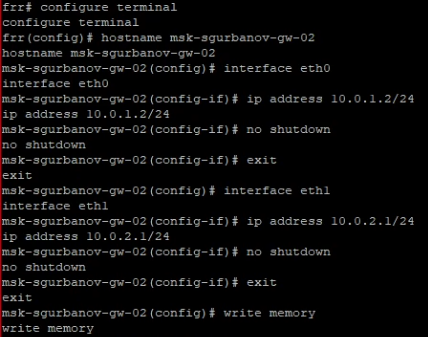

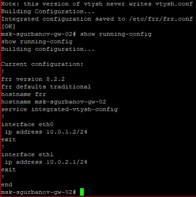

На gw-03 выполнена настройка трёх интерфейсов. На начальных снимках eth0 и eth1 имеют одинаковый адрес `10.0.11.1/24`, тогда как по адресному плану для eth1 предусмотрен `10.0.2.2/24`. На eth2 назначен адрес `10.0.3.1/24`.

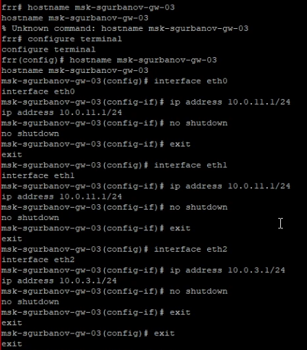

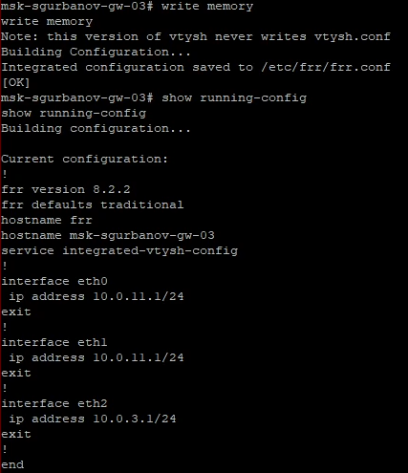

В более позднем выводе `show running-config` на eth1 gw-03 уже присутствует адрес `10.0.2.2/24`, однако адрес `10.0.11.1/24` также сохраняется на этом интерфейсе (рисунок 21). Таким образом, фактическая конфигурация IPv4 gw-03 отличается от адресного плана.

На gw-04 интерфейсу eth0 назначен адрес `10.0.3.2/24`, а eth1 — `10.0.4.1/24`. После настройки конфигурация сохранена и просмотрена.

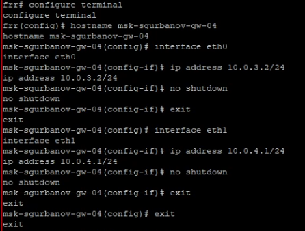

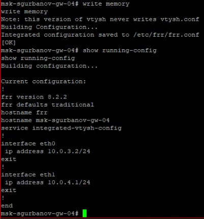

## Настройка адресации IPv6

### Настройка оконечных узлов

На PC1 назначен глобальный адрес `2001:10::a/64`:

```text
ip 2001:10::a/64
save
show ipv6
```

Вывод `show ipv6` содержит глобальный адрес `2001:10::a/64` и локальный для канала адрес `fe80::250:79ff:fe66:6800/64`.

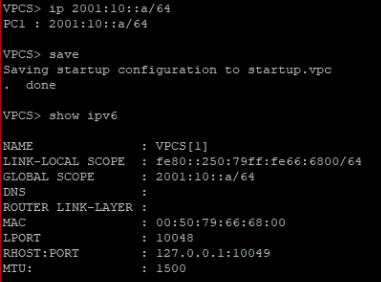

На PC2 назначен глобальный адрес `2001:11::a/64`:

```text
ip 2001:11::a/64
save
show ipv6
```

На узле также присутствует локальный для канала адрес `fe80::250:79ff:fe66:6801/64`.

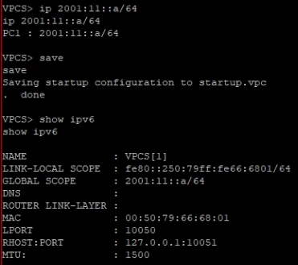

### Настройка маршрутизаторов

На маршрутизаторах включена пересылка IPv6 командой `ipv6 forwarding`. Интерфейсам назначены адреса из таблицы адресации.

На gw-01 интерфейсу eth0 назначен адрес `2001:10::1/64`. Для сегмента PC1 включены объявления маршрутизатора и указан объявляемый префикс:

```text
configure terminal
ipv6 forwarding
interface eth0
 ipv6 address 2001:10::1/64
 no ipv6 nd suppress-ra
 ipv6 nd prefix 2001:10::/64
 no shutdown
 exit
interface eth1
 ipv6 address 2001:1::1/64
 no shutdown
 exit
interface eth2
 ipv6 address 2001:4::2/64
 no shutdown
 exit
exit
write memory
show running-config
```

На снимке настройки eth0 первоначальная опечатка в `suppress-ra` исправлена повторным вводом команды.

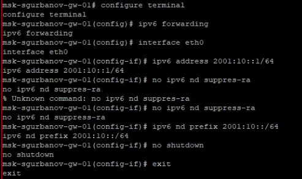

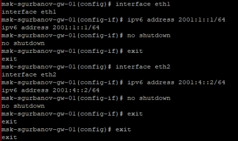

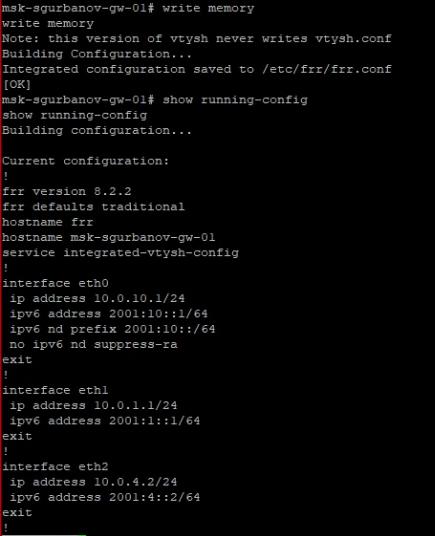

На gw-02 настроены адреса `2001:1::2/64` на eth0 и `2001:2::1/64` на eth1.

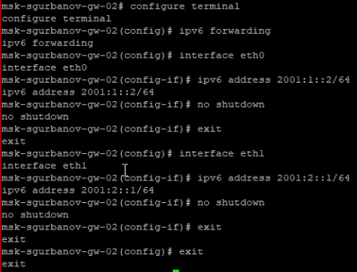

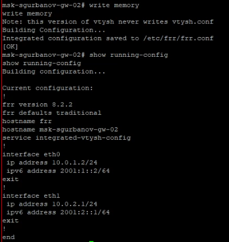

На gw-03 интерфейсу eth0 назначен адрес `2001:11::1/64`. На этом интерфейсе включены Router Advertisement и объявление префикса `2001:11::/64` для сегмента PC2. На eth1 настроен адрес `2001:2::2/64`, на eth2 — `2001:3::1/64`.

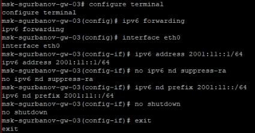

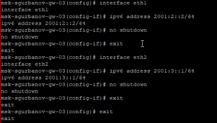

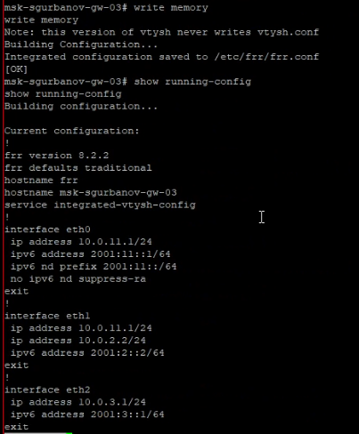

На gw-04 назначены адреса `2001:3::2/64` на eth0 и `2001:4::1/64` на eth1. Вывод конфигурации показывает одновременное наличие адресов IPv4 и IPv6 на этих интерфейсах.

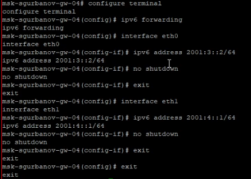

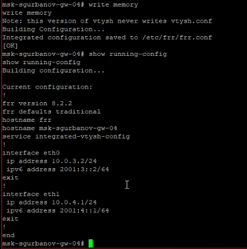

## Настройка динамической маршрутизации RIPv2

### Включение протокола на маршрутизаторах

Для обмена маршрутами IPv4 на маршрутизаторах включён процесс `router rip` и явно выбрана версия 2 командой `version 2`. Команды `network ethX` задают интерфейсы, на которых работает протокол.

На gw-01 выполнены команды:

```text
configure terminal
router rip
 version 2
 network eth0
 network eth1
 network eth2
 exit
exit
write memory
```

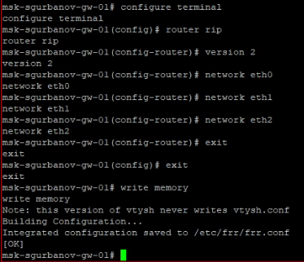

На остальных маршрутизаторах протокол включён аналогично, с учётом используемых интерфейсов.

| Маршрутизатор | Интерфейсы RIPv2 |
| --- | --- |
| gw-01 | eth0, eth1, eth2 |
| gw-02 | eth0, eth1 |
| gw-03 | eth0, eth1, eth2 |
| gw-04 | eth0, eth1 |

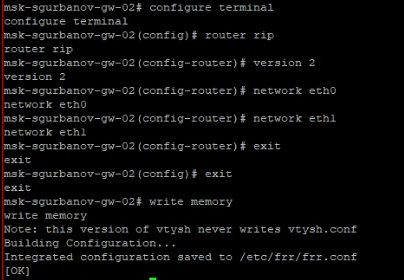

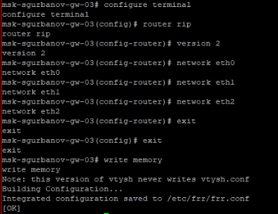

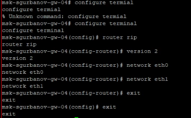

### Проверка таблиц и параметров RIP

На gw-01 выполнены команды:

```text
show ip route rip
show ip rip
show ip rip status
```

Команда `show ip route rip` показывает маршруты, полученные по RIP. На снимке присутствуют следующие записи:

| Сеть назначения | Следующий узел | Выходной интерфейс | Административная дистанция | Метрика |
| --- | --- | --- | --- | --- |
| 10.0.2.0/24 | 10.0.1.2 | eth1 | 120 | 2 |
| 10.0.3.0/24 | 10.0.4.1 | eth2 | 120 | 2 |
| 10.0.11.0/24 | 10.0.4.1 | eth2 | 120 | 3 |

Обозначение `R` указывает на RIP, символ `>` — на выбранный маршрут, а `*` — на маршрут в таблице пересылки. В записи `[120/3]` первое число обозначает административную дистанцию, второе — метрику RIP.

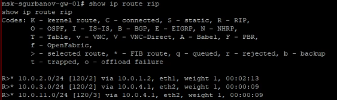

Команда `show ip rip` дополнительно показывает непосредственно подключённые сети, источник маршрута и служебные таймеры. На gw-01 сети `10.0.1.0/24`, `10.0.4.0/24` и `10.0.10.0/24` отмечены как подключённые, а сети `10.0.2.0/24`, `10.0.3.0/24` и `10.0.11.0/24` получены от соседних маршрутизаторов.

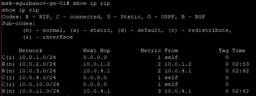

В выводе `show ip rip status` зафиксированы следующие параметры:

- базовый период отправки обновлений — 30 секунд; вывод также указывает вариацию интервала `+/-50%`;
- таймер недействительности маршрута — 180 секунд;
- таймер удаления недействительной записи `garbage collect` — 120 секунд;
- передача и приём сообщений версии 2 на eth0, eth1 и eth2;
- источники маршрутной информации — `10.0.1.2` и `10.0.4.1`;
- административная дистанция — 120.

Счётчики `BadPackets` и `BadRoutes` для обоих источников на снимке равны нулю.

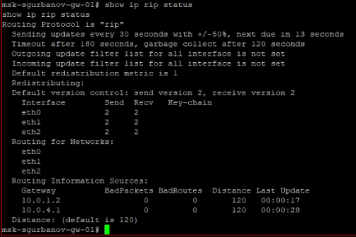

### Проверка связи по IPv4

На PC1 выполнены команды:

```text
ping 10.0.11.10
trace 10.0.11.10 -P 6
```

Все пять запросов `ping` завершаются сообщением `timeout`.

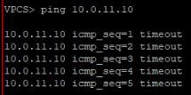

Трассировка показывает ответы от двух маршрутизаторов:

| Шаг | Адрес в ответе | Устройство |
| --- | --- | --- |
| 1 | 10.0.10.1 | gw-01 |
| 2 | 10.0.4.1 | gw-04 |
| 3–8 | Ответ отсутствует | — |

Таким образом, в этой проверке пакеты направляются через gw-04, что согласуется с маршрутом к `10.0.11.0/24` через `10.0.4.1`. Достижение PC2 по IPv4 не подтверждено.

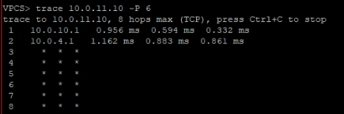

Наличие маршрута в таблице RIP само по себе не подтверждает сквозную связность. На gw-03 обнаружено несоответствие адресному плану: адрес `10.0.11.1/24` назначен одновременно eth0 и eth1. Оно может влиять на доставку IPv4-пакетов и требует проверки; по имеющимся результатам нельзя однозначно установить единственную причину тайм-аутов.

### Отключение интерфейса gw-02 и просмотр состояния RIP

На gw-02 отключён интерфейс eth0:

```text
configure terminal
interface eth0
 shutdown
 exit
exit
write memory
```

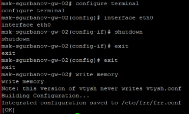

После отключения выполнен повторный просмотр таблиц RIP и состояния протокола на gw-01.

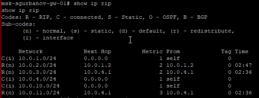

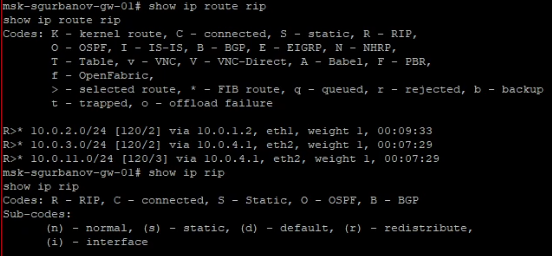

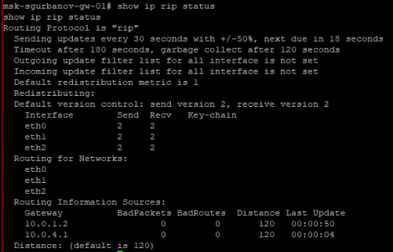

В показанных таблицах маршрут к `10.0.11.0/24` по-прежнему имеет следующий узел `10.0.4.1` и метрику 3. Уже в исходной IPv4-трассировке использовался gw-04, поэтому отключение интерфейса gw-02 в данном опыте не демонстрирует переключение активного пути к PC2. Время восстановления сквозной IPv4-связности по этим снимкам определить нельзя.

## Настройка динамической маршрутизации RIPng

### Включение RIPng на маршрутизаторах

Для обмена маршрутами IPv6 на маршрутизаторах включён процесс `router ripng`. На gw-01 выполнены команды:

```text
configure terminal
router ripng
 network eth0
 network eth1
 network eth2
 exit
exit
write memory
```

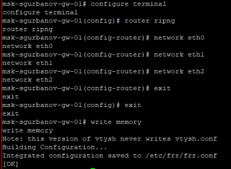

На gw-02 и gw-04 в RIPng включены eth0 и eth1, на gw-03 — eth0, eth1 и eth2. Конфигурации сохранены командой `write memory`.

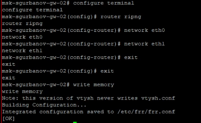

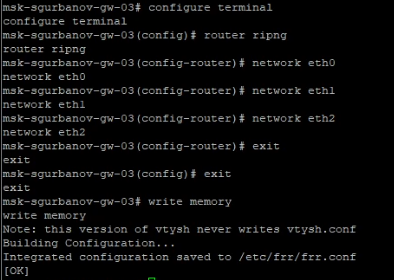

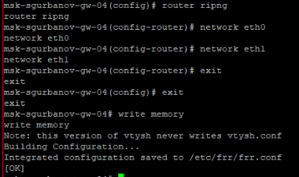

### Проверка связи и пути прохождения пакетов IPv6

На PC1 выполнены команды:

```text
ping 2001:11::a
trace 2001:11::a
```

Получены ответы на все пять запросов `ping`. Время ответа на представленном снимке составляет от 2,064 до 3,826 мс. Это подтверждает доступность PC2 из сети PC1 по IPv6 в момент проверки.

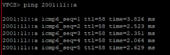

Трассировка показывает следующий путь:

| Шаг | Адрес в ответе | Устройство |
| --- | --- | --- |
| 1 | 2001:10::1 | gw-01 |
| 2 | 2001:1::2 | gw-02 |
| 3 | 2001:2::2 | gw-03 |
| 4 | 2001:11::a | PC2 |

В данной проверке IPv6-трафик проходит от PC1 через gw-01, gw-02 и gw-03 к PC2.

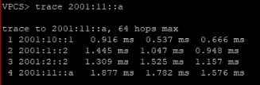

### Анализ таблицы RIPng

На gw-01 выполнена команда:

```text
show ipv6 ripng
```

В таблице присутствуют непосредственно подключённые сети и маршруты, полученные по RIPng:

| Сеть назначения | Источник или следующий узел | Интерфейс | Метрика |
| --- | --- | --- | --- |
| 2001:1::/64 | Непосредственно подключённая сеть | eth1 | 1 |
| 2001:2::/64 | fe80::ede:b2ff:fe5b:0 | eth1 | 2 |
| 2001:3::/64 | fe80::e8c:ddff:fe1f:1 | eth2 | 2 |
| 2001:4::/64 | Непосредственно подключённая сеть | eth2 | 1 |
| 2001:10::/64 | Непосредственно подключённая сеть | eth0 | 1 |
| 2001:11::/64 | fe80::ede:b2ff:fe5b:0 | eth1 | 3 |

Значения метрик приведены по выводу FRR. Интерфейсы непосредственно подключённых сетей сопоставлены с конфигурацией gw-01; в самом выводе RIPng для них указано `self`.

Для изученных маршрутов следующими узлами служат локальные для канала IPv6-адреса соседей. Маршрут к сети PC2 `2001:11::/64` направлен через eth1 к gw-02 и имеет метрику 3, что согласуется с направлением, показанным трассировкой.

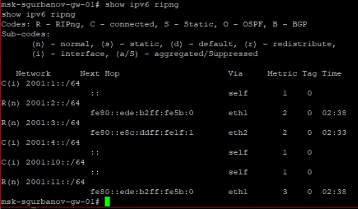

### Отключение интерфейса на используемом пути

На gw-02 отключён интерфейс eth0, через который проходит соединение с gw-01:

```text
configure terminal
interface eth0
 shutdown
 exit
exit
write memory
```

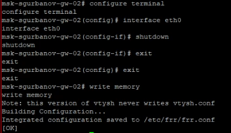

После отключения на PC1 повторены `ping 2001:11::a` и `trace 2001:11::a`. Все пять запросов `ping` завершаются тайм-аутами. При трассировке отвечает gw-01 с адресом `2001:10::1`, после чего появляется сообщение `Address unreachable` с ICMPv6 type 1, code 3.

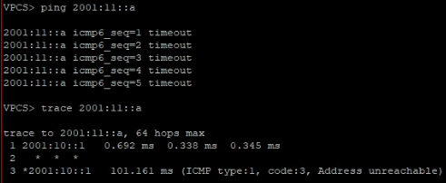

В зафиксированный момент альтернативный путь до PC2 не обеспечил успешную доставку пакетов. Эти результаты показывают потерю связи после разрыва используемого соединения; успешное переключение на gw-04 данным измерением не подтверждается.

### Повторное включение интерфейса и восстановление связи

Интерфейс eth0 на gw-02 включён командой `no shutdown`:

```text
configure terminal
interface eth0
 no shutdown
```

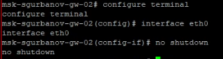

При следующем запуске `ping 2001:11::a` первые три ответа содержат сообщение `Address unreachable` от `2001:10::1`. На четвёртый и пятый запросы получены ответы от PC2 с временем 2,824 и 3,005 мс соответственно. Следовательно, в ходе этой проверки доступность удалённого узла восстановилась.

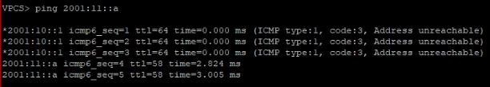

Повторная трассировка снова показывает путь через gw-01, gw-02 и gw-03:

```text
1  2001:10::1
2  2001:1::2
3  2001:2::2
4  2001:11::a
```

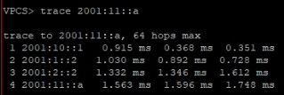

Первые успешные ответы в показанной серии начинаются с запроса № 4. Точное время от выполнения `no shutdown` до восстановления связи по снимкам не определяется, поскольку момент включения интерфейса и интервалы измерений не зафиксированы совместно.

## Результаты проверок

| Проверка | Наблюдаемый результат |
| --- | --- |
| Адресация оконечных узлов | На PC1 и PC2 назначены адреса IPv4 и IPv6 по заданию |
| Обмен маршрутами RIPv2 | На gw-01 присутствуют RIP-маршруты к удалённым IPv4-сетям |
| Доступность PC2 по IPv4 | Пять тайм-аутов; трассировка получает ответы от gw-01 и gw-04 |
| Обмен маршрутами RIPng | На gw-01 присутствуют маршруты к удалённым IPv6-сетям |
| Доступность PC2 по IPv6 до отключения | Получены пять ответов; путь проходит через gw-02 |
| IPv6 после отключения eth0 gw-02 | Тайм-ауты и сообщение `Address unreachable` |
| IPv6 после повторного включения eth0 | В показанной серии ответы PC2 появляются с четвёртого запроса; трассировка вновь достигает PC2 |

# Вывод

В ходе лабораторной работы изучены принципы настройки двойного стека IPv4/IPv6 и динамической маршрутизации RIPv2 и RIPng на маршрутизаторах FRR в среде GNS3. Составлены таблицы адресации, настроены интерфейсы и процессы маршрутизации, рассмотрены таблицы маршрутов и метрики RIP.

Обмен маршрутами IPv4 подтверждён выводом таблиц RIP, однако сквозная доступность PC2 по IPv4 в представленной проверке не достигнута. При анализе конфигурации gw-03 выявлено несоответствие адресному плану: адрес `10.0.11.1/24` присутствует на двух интерфейсах.

Для IPv6 подтверждена связь между PC1 и PC2 через gw-01, gw-02 и gw-03. Отключение eth0 на gw-02 привело к потере доступности PC2 в момент проверки. После повторного включения интерфейса ответы `ping` возобновились, а трассировка снова достигла конечного узла по прежнему пути. Получен практический опыт проверки маршрутизации и анализа влияния состояния интерфейсов на связность сети.

# Список литературы {.unnumbered}

1. Королькова А. В., Кулябов Д. С. Сетевые технологии. Лабораторный практикум. Лабораторная работа № 6 «Адресация IPv4 и IPv6. Настройка маршрутизации по протоколу RIP». С. 59–70. Материалы задания: `006-lab_routing-GNS3-RIP.pdf`.