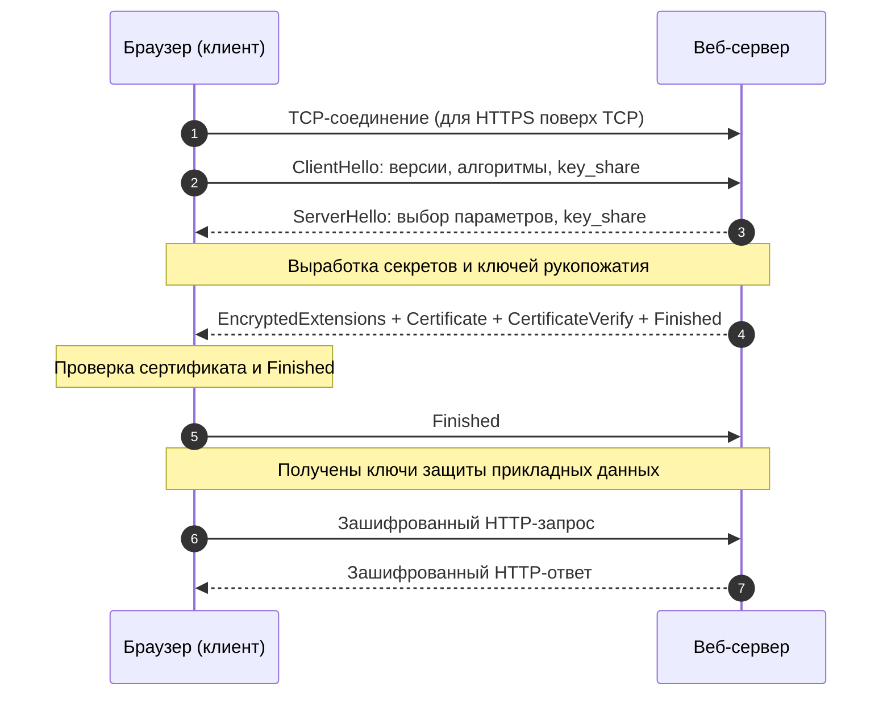
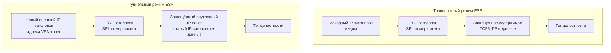
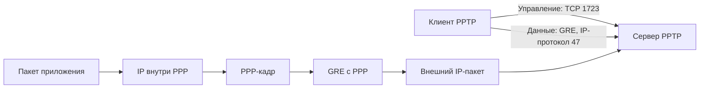
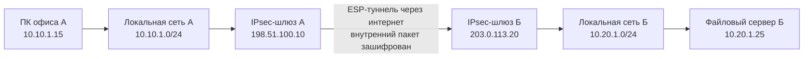

---
## Author
author:
  name: Гурбанов Сарча
  degrees: DSc
  orcid: 0000-0002-0877-7063
  email: 1032244850@rudn.ru
  affiliation:
    - name: Российский университет дружбы народов
      country: Российская Федерация
      postal-code: 117198
      city: Москва
      address: ул. Миклухо-Маклая, д. 6

## Title
title: "Реферат"
subtitle: "Протоколы защищённых каналов: SSL, IPSec, PPTP."
license: "CC BY"
---

# Введение

## Актуальность

Компьютерные сети передают сообщения через оборудование и среды, не всегда контролируемые отправителем и получателем: сети провайдеров, общедоступные точки Wi-Fi, межоператорские магистрали и интернет. На таких участках злоумышленник может пытаться перехватывать пакеты, изменять их содержимое, выдавать себя за одну из сторон либо повторно передавать ранее записанные сообщения. Поэтому для электронного документооборота, веб-сервисов, удалённой работы и взаимодействия филиалов важен **защищённый канал** — логическая связь, в которой определёнными криптографическими механизмами обеспечивается безопасность передаваемых данных.

SSL, IPsec и PPTP относятся к разным этапам развития сетевой защиты и решают частично разные задачи. SSL исторически обеспечивал защищённые сеансы приложений и был заменён семейством TLS; IPsec защищает IP-трафик на сетевом уровне; PPTP создавал туннели для PPP, но типичные схемы его аутентификации и шифрования сегодня неприемлемы для новых защищённых подключений. Их сравнение важно не только для понимания истории сетевых технологий, но и для выбора правильной архитектуры безопасности. Актуальные рекомендации по TLS сформулированы, в частности, в RFC 9325 и RFC 9852; рекомендации по корпоративным IPsec VPN опубликованы NIST [(5)](#source-5), [(15)](#source-15), [(25)](#source-25).

## Цель работы

**Цель** — изучить принципы построения защищённых сетевых каналов, архитектуру и работу SSL/TLS, IPsec и PPTP, определить их возможности, ограничения и области обоснованного применения с учётом современных требований безопасности.

## Задачи

1. Дать определение защищённого канала и раскрыть свойства конфиденциальности, целостности, аутентификации и защиты от повторов.
2. Разграничить понятия шифрования, инкапсуляции и туннелирования.
3. Описать компоненты, установление соединения и ограничения SSL и современного TLS.
4. Рассмотреть AH, ESP, IKEv2, политики и режимы IPsec, включая прохождение NAT.
5. Разобрать построение PPTP поверх PPP и причины отказа от этой технологии.
6. Проследить путь данных в четырёх условных практических сценариях.
7. Сравнить технологии и сформулировать рекомендации по выбору.

## Объект и предмет исследования

**Объект** — передача информации через недоверенные сети. **Предмет** — протоколы защищённых каналов, их средства криптографической защиты, механизмы организации соединений и границы действия защиты.

# Теоретическая часть

## 1. Защищённый канал и его свойства

Защищённый канал — это не обязательно отдельный физический провод и не обязательно VPN. Обычно это логическая связь между двумя **конечными точками криптографической защиты**, которые согласовали алгоритмы и ключи и обрабатывают проходящие сообщения по правилам безопасности. Такими точками могут быть браузер и веб-сервер, два VPN-шлюза либо ноутбук сотрудника и корпоративный шлюз. Защита распространяется только на определённый участок пути и определённые поля сообщений.

Основные свойства следующие:

- **Конфиденциальность** — посторонний наблюдатель не должен узнавать содержимое защищённых данных. Обычно её обеспечивает шифрование с секретным сеансовым ключом.
- **Целостность** — получатель способен выявить несанкционированное изменение защищённого сообщения. Для этого применяют коды аутентификации сообщений (MAC) или аутентифицированное шифрование (AEAD), например AES-GCM; одно лишь шифрование целостность не гарантирует.
- **Аутентификация** — проверка того, с кем устанавливается связь. Для неё используют сертификаты, цифровые подписи, предварительно согласованные секреты и другие механизмы. Важно различать аутентификацию сервера, устройства и конкретного пользователя.
- **Защита от повторного воспроизведения** (*anti-replay*) — отклонение старых пакетов, которые злоумышленник записал и послал заново. Используются порядковые номера, контроль допустимого окна номеров и криптографическая привязка номера к сообщению. Защита от повторов не равнозначна целостности: неизменённый, но повторённый пакет тоже может быть опасен.

Для оценки также важны **прямая секретность** (*forward secrecy*, защита ранее записанных сеансов при последующей компрометации долгосрочного ключа), доступность, управление сроком жизни ключей, журналирование и защита конечных узлов. Ни одна из трёх рассматриваемых технологий сама по себе не гарантирует доступность системы или отсутствие вредоносного ПО на компьютере пользователя [(1)](#source-1), [(10)](#source-10), [(15)](#source-15).

### 1.1. Шифрование, инкапсуляция и туннелирование

**Шифрование** преобразует открытый текст в шифртекст по криптографическому алгоритму с ключом. Цель — скрыть содержимое, а при использовании AEAD также обнаружить изменение зашифрованных данных. **Инкапсуляция** помещает пакет или кадр одного протокола внутрь сообщения другого протокола. **Туннелирование** использует такую инкапсуляцию, чтобы передавать один вид сетевого трафика через другую сеть, будто между концами есть логический канал. Туннель может быть как защищённым, так и вовсе незашифрованным.

| Механизм | Что делает | Чего сам по себе не гарантирует | Иллюстрация |
|---|---|---|---|
| Шифрование | Скрывает содержимое данных | Маршрутизацию и сокрытие адресов | TLS шифрует HTTP-запрос |
| Контроль целостности | Позволяет обнаружить изменение защищённых данных | Секретность | AH проверяет подлинность и целостность пакета, но не шифрует его |
| Туннелирование | Переносит внутренний пакет внутри внешнего | Шифрование и стойкую аутентификацию | PPTP переносит кадры PPP через GRE |
| Защищённый VPN-туннель | Совмещает перенос трафика с криптографической защитой | Защиту данных за пределами туннеля | IPsec ESP в туннельном режиме |

Например, в IPsec VPN исходный внутренний IP-пакет можно зашифровать **и затем** заключить во внешний IP-пакет. PPTP тоже создаёт туннель, однако безопасность передаваемых данных зависит от дополнительных механизмов PPP, прежде всего MPPE, которые сейчас считаются устаревшими. TLS обычно защищает данные конкретного приложения; сам TLS не означает инкапсуляцию всех IP-пакетов устройства [(10)](#source-10), [(12)](#source-12), [(16)](#source-16).

## 2. SSL и современный TLS

### 2.1. Назначение и уровни взаимодействия

**SSL** (*Secure Sockets Layer*, «уровень защищённых сокетов») — историческое семейство протоколов защищённой передачи данных между клиентом и сервером. Его назначение состояло в согласовании криптографических параметров, проверке стороны соединения и защите потока прикладных данных. Последняя публично описанная версия SSL 3.0 приведена в RFC 6101. В современном интернете задачи SSL выполняет **TLS** (*Transport Layer Security*). Название «SSL-сертификат» сохранилось в разговорной речи и коммерческих услугах, но корректнее говорить «сертификат для TLS» [(2)](#source-2), [(3)](#source-3).

Упрощённая модель для HTTPS через TCP выглядит так: `HTTP → TLS → TCP → IP → канал передачи`. TLS расположен между прикладным протоколом и транспортом, поэтому защищает, например, HTTP, почтовые протоколы и отдельные соединения приложений, но не весь IP-трафик устройства. В HTTP/3 TLS 1.3 используется внутри QUIC; это особая интеграция, а не обычный TLS-поток поверх TCP [(1)](#source-1), [(8)](#source-8).

### 2.2. Основные компоненты

Для исторического SSL 3.0 обычно выделяют **Handshake Protocol** (согласование параметров и установление секретов), **Record Protocol** (передача защищённых записей), **ChangeCipherSpec** (сигнал о переходе к согласованным параметрам защиты) и **Alert Protocol** (уведомления об ошибках и закрытии). У TLS сохранились идеи рукопожатия и записи, но структура сообщений, алгоритмы и назначение отдельных сигналов изменились. В частности, в TLS 1.3 `ChangeCipherSpec` не управляет переключением реальных ключей так, как это было в старых версиях [(2)](#source-2), [(1)](#source-1).

Современный TLS включает:

1. **Рукопожатие (handshake)** — выбор версии, параметров, выработка общего секрета и аутентификация.
2. **Записи (records)** — фрагменты передаваемых данных, защищаемые симметричными ключами и проверкой целостности.
3. **Сертификаты X.509 и инфраструктуру доверия PKI** — способ связать публичный ключ сервера с доменным именем через цепочку сертификатов и доверенные удостоверяющие центры.
4. **Криптографические примитивы** — обмен ключевым материалом, цифровые подписи, функции выработки ключей и AEAD-шифры.
5. **Сигналы управления и ошибок** — например, уведомления об ошибках проверки и закрытии защищённого соединения.

### 2.3. Установление TLS 1.3-соединения, сертификаты и ключи

При типичном полном установлении TLS 1.3 клиент посылает `ClientHello`: поддерживаемые версии и алгоритмы, случайные значения и параметры обмена ключами. Сервер отвечает `ServerHello`, выбирает параметры и передаёт свою долю материала для согласования секрета. В распространённом варианте используется временный обмен ключами на эллиптических кривых (ECDHE). Далее сервер **в уже защищённой части рукопожатия** передаёт настройки, сертификат, подпись `CertificateVerify` и подтверждение `Finished`. Клиент проверяет цепочку доверия, срок действия, допустимость сертификата и соответствие имени сайта; затем подтверждает обмен сообщением `Finished`. Обе стороны независимо выводят симметричные ключи для шифрования прикладного трафика [(1)](#source-1).

**Сертификат не является общим секретным ключом и обычно не используется для непосредственного шифрования всей веб-страницы.** Он позволяет проверить подлинность серверного ключа. Симметричные сеансовые ключи выводятся из согласованного криптографического секрета; они могут обновляться в ходе работы. При временном обмене ключами компрометация долгосрочного ключа сертификата позднее сама по себе не раскрывает содержимое корректно установленных прошлых сеансов. В обычном HTTPS сервер предъявляет сертификат, а пользователь дополнительно аутентифицируется, например, через веб-форму; возможны также клиентские сертификаты (mTLS) [(1)](#source-1), [(5)](#source-5).

**Рисунок 1 — Упрощённое установление TLS 1.3 и обмен данными HTTPS.** Схема описывает полноценное соединение без возобновления сеанса, 0-RTT и промежуточного TLS-прокси. Данные сертификата сервера и часть сообщений после `ServerHello` шифруются ключами рукопожатия; HTTP передаётся только после установления соответствующей защиты. В старом SSL последовательность и криптографические алгоритмы отличались [(1)](#source-1).

### 2.4. Почему SSL устарел и чем TLS отличается от него

SSL 2.0 и SSL 3.0 проектировались для иной технологической и криптографической обстановки. SSL 3.0 связан с уязвимыми устаревшими механизмами и возможностью атак на конфиденциальность; его применение официально запрещено RFC 7568. Позднее IETF вывела из употребления TLS 1.0 и 1.1 (RFC 8996). TLS 1.3 упростил набор криптографических алгоритмов, исключил ряд прежних опасных вариантов обмена ключами, использует современные схемы аутентифицированного шифрования и существенно переработал рукопожатие [(3)](#source-3), [(4)](#source-4), [(5)](#source-5).

| Аспект | Исторический SSL 3.0 | Современный TLS 1.3 |
|---|---|---|
| Нормативная основа | RFC 6101 — историческое описание | RFC 9846 (2026), заменивший RFC 8446 (2018) |
| Применение | Не следует использовать | Предпочтительный вариант для новых внедрений |
| Криптография | Устаревшие наборы алгоритмов и формат рукопожатия | Современный обмен ключами и AEAD |
| Прямая секретность | Не была гарантированным свойством распространённых конфигураций | В обычном полном соединении обеспечивается временным обменом ключами |
| Передача сертификата | В историческом SSL передавался открыто | В TLS 1.3 серверный сертификат передаётся в зашифрованной части рукопожатия |
| Защита HTTP | Исторически применялась | Штатно применяется в современном HTTPS |

Важно не путать **устаревший SSL** с **TLS 1.2**, который при корректной настройке всё ещё может использоваться в существующих системах. Для новых протоколов RFC 9852 требует TLS 1.3 как основной вариант; RFC 10015 (2026) дополнительно исключает из TLS 1.2 устаревшие способы согласования ключей, включая статический RSA-обмен [(6)](#source-6), [(25)](#source-25). Актуальная спецификация TLS 1.3 — RFC 9846, опубликованная в июле 2026 года [(1)](#source-1).

### 2.5. HTTPS: что действительно защищено

HTTPS — передача HTTP через криптографически защищённое соединение. При открытии сайта браузер узнаёт адрес сервера через DNS, устанавливает транспортное соединение (например, TCP с портом 443), выполняет рукопожатие TLS и только затем передаёт HTTP-запрос. Путь URL, параметры запроса, заголовки HTTP, cookie и тело запроса в типичном TLS 1.3 защищены внутри TLS; то же относится к HTTP-ответу. Однако сетевым наблюдателям обычно видны внешние IP-адреса, порт, размеры и время пакетов. Имя сайта может быть раскрыто незашифрованным DNS-запросом и полем SNI в `ClientHello`; расширение ECH способно защитить внутреннее имя SNI при поддержке на обеих сторонах, но не скрывает IP-адрес назначения [(7)](#source-7), [(9)](#source-9).

Сам факт значка замка не доказывает добросовестность сайта: TLS подтверждает связь с указанным именем при корректной проверке сертификата, а не честность владельца ресурса. На обратном прокси, балансировщике или CDN TLS может заканчиваться раньше, чем на конечном сервере приложения; дальнейший участок требует собственной защиты. Если приложение отправляет данные в виде обычного HTTP после завершения TLS на прокси, шифрование первого участка не защищает второй.

### 2.6. Преимущества и ограничения TLS

**Преимущества:** распространённость в браузерах и серверных приложениях; сравнительно удобная проверка имени через PKI; надёжная конфиденциальность и целостность при безопасной конфигурации; поддержка современной криптографии; защита отдельных сервисов без маршрутизации всей сети.

**Ограничения:** защищает соединение только между конкретными TLS-точками; не скрывает большую часть сетевых метаданных; зависит от проверки сертификатов и настроек клиента/сервера; не спасает от компрометации конечной системы. Отдельно следует учитывать **TLS 1.3 0-RTT**: предварительные данные при возобновлении соединения могут быть воспроизведены повторно, поэтому операции с необратимыми последствиями нельзя без дополнительных мер безопасности выполнять на основе 0-RTT [(1)](#source-1), [(5)](#source-5).

## 3. IPsec: защищённые IP-пакеты

### 3.1. Назначение и работа на сетевом уровне

**IPsec** (*Internet Protocol Security*) — архитектура протоколов безопасности для IP на **сетевом уровне**. В отличие от TLS, IPsec способен защищать IP-трафик нескольких приложений без изменения самих приложений. Он применяется непосредственно на компьютерах, маршрутизаторах и VPN-шлюзах. Архитектура определяет протоколы защиты пакетов, базы политик и ассоциаций безопасности, способы обработки входящих и исходящих пакетов [(10)](#source-10).

Типичные сценарии: VPN между локальными сетями филиалов (*site-to-site*), защищённая связь отдельного хоста с корпоративным шлюзом (*remote access*) и соединения «хост—хост». Термин VPN обозначает виртуальную частную сеть, в которой трафик логически передаётся по туннелю через сеть общего пользования; безопасность VPN зависит от применённой криптографии и настроек [(15)](#source-15).

### 3.2. AH, ESP и IKEv2

| Компонент | Функция | Шифрует ли содержимое? | Существенная особенность |
|---|---|---|---|
| **AH** — Authentication Header | Проверка источника и целостности защищённых данных, защита от повторов при соответствующем использовании | Нет | Охватывает также некоторые неизменяемые поля IP-заголовка; плохо совместим с обычным NAT |
| **ESP** — Encapsulating Security Payload | Конфиденциальность, целостность и аутентификация данных (при правильном выборе алгоритмов), anti-replay | Да, когда включено шифрование | Основной механизм большинства современных IPsec VPN |
| **IKEv2** — Internet Key Exchange v2 | Взаимная аутентификация узлов, согласование алгоритмов, ключей и IPsec SA | Не является протоколом шифрования пользовательских IP-пакетов | Строит защищённый управляющий обмен и согласует дочерние SA для ESP/AH |

AH описан RFC 4302, ESP — RFC 4303, IKEv2 — RFC 7296. В современных VPN обычно используют **ESP с аутентифицированным шифрованием** и **IKEv2**. AH не обеспечивает секретность и часто не нужен, поскольку ESP уже способен контролировать целостность полезных данных. Изменения адресов при NAT конфликтуют с аутентификацией полей IP-заголовка в AH [(11)](#source-11), [(12)](#source-12), [(13)](#source-13).

### 3.3. Ассоциации безопасности и политика обработки

**SA** (*Security Association*, ассоциация безопасности) — набор параметров для обработки трафика: способ защиты, ключи, идентификаторы, алгоритмы, срок действия, счётчики пакетов. Для ESP и AH ассоциация применяется в одном направлении; поэтому двусторонний обмен использует связанные SA для обоих направлений. SA идентифицируются, в частности, по индексу параметров безопасности **SPI** и соответствующим сетевым параметрам.

В архитектуре используются две важные базы:

- **SPD (Security Policy Database)** — *база политик безопасности*. Правила определяют, какие пакеты следует **защищать** (`PROTECT`), **пропускать без IPsec** (`BYPASS`) или **отбрасывать** (`DISCARD`), исходя из адресов, протоколов, портов и других селекторов.
- **SAD (Security Association Database)** — *база ассоциаций*. Содержит действующие SA и параметры криптографической обработки.

Например, политика может требовать шифровать пакеты из сети `10.10.1.0/24` в `10.20.1.0/24`, но пропускать локальный трафик к принтеру без VPN. Если подходящей SA нет, IKEv2 помогает согласовать её. Ошибка политики способна привести к обходу туннеля или блокированию трафика, даже если криптографические алгоритмы надёжны [(10)](#source-10), [(13)](#source-13).

### 3.4. Транспортный и туннельный режимы

В **транспортном режиме** ESP защищает содержимое исходного IP-пакета (например, TCP-сегмент), оставляя внешний исходный IP-заголовок, необходимый для маршрутизации. Обычно такой режим рассматривают при связи конечных хостов.

В **туннельном режиме** внутрь ESP помещается **целый исходный IP-пакет** вместе с его исходными адресами, а снаружи добавляется новый IP-заголовок между концами туннеля (часто VPN-шлюзами). В таком режиме наблюдатель в интернете видит адреса VPN-шлюзов, но не исходные адреса компьютеров внутри зашифрованного пакета. Схема ниже показывает случай ESP с шифрованием и контролем целостности; детали полей и аутентификационных тегов опущены [(10)](#source-10), [(12)](#source-12).

**Рисунок 2 — Сопоставление транспортного и туннельного режимов IPsec ESP.** Различается не «сила шифра», а **объём инкапсулируемого и защищаемого содержимого**: в туннельном режиме исходный IP-заголовок находится внутри защиты, в транспортном — нет. Наружные служебные поля, нужные для доставки и обработки ESP, не скрыты.

### 3.5. Согласование ключей, взаимная аутентификация и anti-replay

Процесс обычно начинается с обмена **IKE_SA_INIT**: стороны согласуют криптографические параметры, выполняют обмен Диффи — Хеллмана и получают общий секрет. Затем в **IKE_AUTH** они аутентифицируют друг друга (например, с помощью сертификатов или заранее согласованных ключей; для пользователя удалённого доступа могут применяться варианты EAP) и создают первую пару **CHILD_SA** для защиты ESP-трафика. В дальнейшем **CREATE_CHILD_SA** позволяет создавать или обновлять ассоциации и ключи. Защищённая IKE SA используется для управляющих сообщений, а CHILD SA — для пользовательских пакетов [(13)](#source-13).

У ESP в заголовке есть **порядковый номер пакета**. При включённой защите от повторов приёмник аутентифицирует пакет и отслеживает окно допустимых номеров. Уже принятый номер или номер, вышедший за пределы окна, отклоняется. Это препятствует простому повтору перехваченных ESP-пакетов, но не заменяет проверку пользовательских операций на уровне приложения (например, защиту от повторного списания средств). Прямая секретность обеспечивается свойствами согласования временных секретов, а не самим фактом существования IPsec [(12)](#source-12), [(13)](#source-13).

### 3.6. Прохождение NAT

**NAT** (*Network Address Translation*) изменяет сетевые адреса и иногда порты между внутренней и внешней сетью. Для IPsec это осложнение: прямые ESP-пакеты используют номер IP-протокола **50**, а не TCP/UDP-порт; AH ещё и проверяет некоторые поля IP-заголовка, которые NAT меняет.

Для ESP предусмотрен механизм **NAT Traversal (NAT-T)**. IKEv2 распознаёт наличие NAT; обычно первоначальные IKE-сообщения идут по **UDP 500**, а при использовании NAT-T IKE и инкапсулированный ESP используют **UDP 4500**. Внешняя оболочка `IP / UDP / ESP` позволяет обычному NAT обрабатывать пакеты как UDP-трафик. Важно: UDP 4500 не «создаёт шифрование» — криптографическую защиту по-прежнему выполняет ESP; NAT-T обеспечивает доставку через трансляцию адресов [(13)](#source-13), [(14)](#source-14).

### 3.7. Преимущества и ограничения IPsec

**Преимущества:** защита IP-трафика разных приложений; построение VPN между целыми подсетями; зрелая архитектура безопасности; гибкие политики; взаимная аутентификация шлюзов; возможность скрыть внутренние IP-адреса в туннельном режиме.

**Ограничения:** сложность настройки SA, алгоритмов, сертификатов и маршрутизации; дополнительные заголовки и потребление ресурсов; зависимость от корректных правил SPD и безопасности конечных узлов; видимость внешних адресов и характеристик потока; необходимость учитывать NAT, межсетевые экраны и фрагментацию. NIST рекомендует рассматривать IPsec VPN как часть общей архитектуры защиты, а не как замену контроля доступа на серверах [(15)](#source-15).

## 4. PPTP: историческая технология VPN

### 4.1. Назначение и принцип работы

**PPTP** (*Point-to-Point Tunneling Protocol*) создавался для переноса соединений **PPP** (*Point-to-Point Protocol*, протокол «точка — точка») через IP-сеть. В 1990-е и 2000-е годы он был распространённым способом подключить домашний или командировочный компьютер к локальной сети организации через интернет. PPTP не разрабатывался как полноценная современная криптографическая архитектура: его основная роль — **туннелирование PPP**, а аутентификация и возможное шифрование выполняются отдельными механизмами PPP [(16)](#source-16), [(17)](#source-17).

Внутри туннеля PPP может согласовывать параметры связи, запускать механизм аутентификации и переносить пакеты сетевых протоколов. В исторических конфигурациях Microsoft часто сочетались PPTP, MS-CHAPv2 и MPPE — три разных механизма с разными задачами.

### 4.2. Управление по TCP 1723 и передача данных по GRE

PPTP использует два **логически различных потока**:

1. **Управляющее соединение TCP с портом назначения 1723** — установка и завершение PPTP-сеанса, управляющие сообщения о состоянии и вызовах.
2. **Поток данных по расширенному GRE** (*Generic Routing Encapsulation*) — перенос кадров PPP, включая IP-пакеты пользователя после их упаковки в PPP. GRE — это отдельный IP-протокол, **номер 47**, а не «порт 47 TCP/UDP».

Управление и данные проходят независимо по типу IP-полезной нагрузки, но относятся к одному PPTP-сеансу. Из-за этого некоторые NAT и межсетевые экраны не пропускают PPTP корректно без специальной обработки. Порт TCP 1723 сам по себе не переносит пользовательский трафик VPN [(16)](#source-16).

**Рисунок 3 — Архитектура PPTP: раздельные управляющий TCP-канал и GRE-поток данных.** Нижняя цепочка показывает упаковку пользовательского IP-пакета в PPP, затем в GRE и внешний IP. Если в PPP согласован MPPE, он шифрует соответствующие данные PPP до их передачи внутри GRE; сам GRE и внешние IP-адреса не становятся зашифрованными [(16)](#source-16), [(19)](#source-19).

### 4.3. Различия между PPTP, PPP, MS-CHAPv2 и MPPE

| Название | Уровень задачи | Что обеспечивает | Чего не обеспечивает само по себе |
|---|---|---|---|
| **PPTP** | Туннель через IP | Управление туннелем, передача PPP через GRE | Сильную криптографическую защиту |
| **PPP** | Канальный протокол «точка — точка» | Формат кадров, согласование параметров LCP/NCP, возможность подключить аутентификацию | Обязательное шифрование |
| **MS-CHAPv2** | Аутентификация в PPP | Проверку знания секрета по схеме «вызов — ответ» | Современную криптографическую стойкость и защиту данных |
| **MPPE** | Дополнительное шифрование PPP | Шифрование соответствующих данных PPP с использованием RC4 | Современную комплексную аутентифицированную защиту уровня ESP/TLS |

MS-CHAPv2 описан RFC 2759, MPPE — RFC 3078, способы получения ключей MPPE — RFC 3079. Из этого следует важный вывод: фраза «PPTP шифрует данные» технически неточна. **PPTP туннелирует; MPPE может шифровать; MS-CHAPv2 аутентифицирует и в типичных конфигурациях участвует в получении ключевого материала** [(18)](#source-18), [(19)](#source-19), [(20)](#source-20).

### 4.4. Недостатки безопасности и причины отказа

Ключевая проблема широко применявшихся конфигураций PPTP — зависимость от **MS-CHAPv2** и **MPPE**. Microsoft в 2012 году официально описала криптографические слабости MS-CHAPv2: при перехвате обмена «вызов — ответ» его стойкость сводилась к перебору уровня одного 56-битного DES-ключа; возможно восстановление материала, достаточного для имитации пользователя. При использовании такого механизма для получения ключей MPPE компрометируется и конфиденциальность VPN-трафика. MPPE основан на устаревшем потоковом шифре RC4 и не соответствует современному подходу с AEAD-защитой. PPTP в типичных вариантах также не даёт такого уровня криптографической аутентификации и защиты от повторов, какой дают корректно настроенные TLS 1.3 или IPsec ESP [(19)](#source-19), [(20)](#source-20), [(21)](#source-21).

Это не означает, что все возможные способы аутентификации PPP математически одинаково слабы; однако **PPTP не следует выбирать для нового защищённого удалённого доступа**. Характерный признак отказа от наследия: начиная с Windows Server 2025 новые установки службы RRAS по умолчанию не принимают PPTP и L2TP-подключения, хотя для совместимости при обновлении ранее настроенных систем возможность подключения может сохраняться. Это административная политика продукта и не свидетельствует о «безопасности после обновления» [(22)](#source-22).

**Исторические достоинства PPTP:** простота установки на старых операционных системах, прежняя широкая совместимость и невысокие требования к оборудованию. **Современные ограничения:** небезопасная типовая криптография, ограниченная функциональность, сложности с NAT/GRE и высокая вероятность ошибок при поддержке устаревших конфигураций.

# Материалы и методы

Работа представляет собой **аналитический обзор**, а не отчёт о проведённом эксперименте. Для проверки сведений использованы открытые первичные источники: спецификации IETF/RFC Editor, руководство NIST по IPsec VPN, материалы Microsoft по протоколам удалённого доступа. Исторические документы использованы для описания устройства SSL 3.0 и PPTP; современные требования безопасности — для выводов о целесообразности применения. Нормативные документы и рекомендации сопоставлены **по состоянию на 20 ноября 2026 года**.

Метод анализа включает четыре шага: (1) выделение свойств безопасности; (2) определение уровня модели сети и конечных точек защиты; (3) восстановление последовательности установления канала и прохождения пакетов; (4) сравнение угроз, видимых метаданных и ограничений. Для примеров используются **вымышленные учебные ситуации** и адреса из диапазонов, предназначенных для документации по RFC 5737. Схемы Mermaid составлены специально для данного реферата по описаниям RFC; внешние изображения не использованы [(23)](#source-23).

# Практическая часть: учебные примеры

## 5. HTTPS: открытие сайта и отправка формы

**Учебные участники и адреса.** Пользователь открывает в браузере условный сайт `https://portal.example/login`. В учебной модели IP-адрес сервера — `203.0.113.10`, клиент выходит в интернет через домашний роутер с внешним адресом `198.51.100.25`. Эти домен, страница и адреса приведены **только как пример**: они не описывают реальную работающую инфраструктуру. Между браузером и сервером находятся домашний маршрутизатор, провайдер и сетевые узлы интернета.

**Последовательность соединения:**

1. Браузер узнаёт IP-адрес условного сервера через DNS. Способ защиты самого DNS-запроса зависит от отдельной настройки DNS и не обеспечивается автоматически протоколом HTTPS.
2. При варианте HTTPS поверх TCP клиент устанавливает TCP-соединение с сервером на порт 443.
3. Стороны обмениваются сообщениями TLS 1.3, согласуют параметры и ключи, а клиент проверяет сертификат условного `portal.example` (рисунок 1).
4. Браузер отправляет внутри TLS запись HTTP-запроса `GET /login`, получает HTML-страницу и показывает форму.
5. Пользователь вводит имя и пароль; браузер отправляет HTTP-запрос `POST /login` с данными формы внутри защищённого соединения. Сервер принимает запись TLS, проверяет подлинность, расшифровывает запрос и передаёт его приложению.

**Путь данных:** браузер → TLS-записи → TCP/IP → маршрутизатор → провайдер → интернет → TLS-сервер → веб-приложение; ответ идёт обратно. **Шифрование** происходит в TLS-реализации браузера, **расшифрование** — на сервере или на его TLS-терминаторе (например, балансировщике).

**Защищено:** содержимое HTTP-запроса и ответа, в том числе путь URL, параметры, cookie, данные формы и заголовки HTTP. **Обычно видно наблюдателю:** IP-адреса, TCP-порт, размеры и время пакетов; при обычных DNS и ClientHello могут быть видны доменное имя из DNS и SNI. ECH уменьшает утечку имени в TLS ClientHello при фактическом использовании, но не скрывает внешние IP-адреса. **Начало и конец защиты:** от TLS-реализации браузера до точки завершения TLS на стороне сервиса. Если между ней и базой данных работает другой незащищённый протокол, TLS браузера этот дополнительный участок не охватывает [(1)](#source-1), [(7)](#source-7), [(9)](#source-9).

Важно: схема показывает HTTPS поверх TCP. Если используется HTTP/3, роль транспорта выполняет QUIC с интеграцией TLS 1.3; принцип защиты HTTP-содержимого сохраняется, но последовательность транспортных сообщений другая [(8)](#source-8).

## 6. IPsec VPN между двумя офисами

**Учебная ситуация и участники.** Есть условный офис А с локальной сетью `10.10.1.0/24` и VPN-шлюзом с внешним адресом `198.51.100.10`. Офис Б использует сеть `10.20.1.0/24` и шлюз `203.0.113.20`. Сотрудник офиса А с компьютера `10.10.1.15` обращается к файловому серверу офиса Б `10.20.1.25`. Публичные адреса — **документационные**, а внутренние — условные частные; реальное подключение здесь не выполняется.

**Рисунок 4 — Учебный IPsec VPN между двумя офисами.** Шлюзы — криптографические границы туннеля; рабочая станция и файловый сервер находятся за ними. Провайдер видит внешний IP-трафик между `198.51.100.10` и `203.0.113.20`, но при корректно настроенном ESP не читает внутренний IP-пакет. Сама по себе защита между шлюзами не шифрует локальные участки «компьютер—шлюз» и «шлюз—сервер» [(10)](#source-10), [(12)](#source-12).

**Последовательность соединения:**

1. Администраторы задают маршруты и политики SPD: трафик между `10.10.1.0/24` и `10.20.1.0/24` должен идти через IPsec ESP.
2. Шлюзы устанавливают управляющую IKE SA через **IKE_SA_INIT**, согласуют криптографию и общий секрет, а через **IKE_AUTH** проверяют друг друга по сертификатам или заранее настроенным ключам и создают CHILD SA.
3. Компьютер А формирует обычный внутренний пакет `10.10.1.15 → 10.20.1.25`. Шлюз А по SPD определяет, что его нужно защитить.
4. Шлюз А шифрует внутренний IP-пакет и помещает его в ESP, добавляя наружный заголовок `198.51.100.10 → 203.0.113.20`.
5. Через интернет передаётся внешний пакет. Шлюз Б проверяет целостность, номер пакета и SA, расшифровывает его, извлекает внутренний IP-пакет и передаёт файловому серверу.
6. Ответ проходит через обратную SA в противоположном направлении.

**Путь:** компьютер А → локальная сеть А → шлюз А → интернет (ESP) → шлюз Б → локальная сеть Б → сервер Б. **Точки шифрования и расшифрования:** соответственно шлюз А и шлюз Б; на обратном пути роли меняются. **Защищено:** весь внутренний пакет, включая адреса `10.10.1.15` и `10.20.1.25`, его транспортные заголовки и содержимое; **остаётся видимым:** внешние адреса шлюзов, факт передачи ESP либо UDP 4500 при NAT-T, объём, размеры и время пакетов. **Границы:** ровно между двумя IPsec-шлюзами. При необходимости дополнительно защитить локальные сегменты используют, например, TLS до самого файлового сервера [(10)](#source-10), [(13)](#source-13), [(14)](#source-14).

## 7. Удалённое подключение сотрудника через IPsec/IKEv2

**Учебная ситуация и участники.** Сотрудник работает из гостиницы на ноутбуке, который получает внешний адрес `198.51.100.50` (условное обозначение). Корпоративный VPN-шлюз имеет адрес `203.0.113.20`. После аутентификации ноутбук получает условный внутренний VPN-адрес `10.20.250.10` и должен подключаться к корпоративному сервису `10.20.1.80`. Между ними — гостиничный Wi-Fi, NAT гостиницы, провайдеры и интернет. Все адреса и обстоятельства **учебные**.

**Последовательность соединения:**

1. Пользователь запускает корпоративный VPN-клиент, который связывается со шлюзом по IKEv2 (обычно начиная с UDP 500).
2. В `IKE_SA_INIT` согласуются алгоритмы и временный общий секрет, а также выявляется наличие NAT; при необходимости обмен переходит на UDP 4500.
3. В `IKE_AUTH` шлюз подтверждает свою подлинность, а ноутбук — подлинность устройства или пользователя: например, сертификатом клиента либо предусмотренной конфигурацией EAP. Создаются ключи ESP и CHILD SA, назначаются политики и параметры доступа.
4. Ноутбук направляет пакет к `10.20.1.80` в VPN-интерфейс. Он шифруется ESP **на самом ноутбуке**, а не на гостиничном роутере, и проходит через интернет к корпоративному шлюзу.
5. Шлюз проверяет и расшифровывает пакет, передаёт его во внутреннюю сеть. Ответ шифруется на шлюзе и расшифровывается ноутбуком.

**Путь:** приложение ноутбука → VPN-интерфейс/ESP → Wi-Fi → NAT/интернет → корпоративный VPN-шлюз → корпоративная сеть → сервис. **Точки шифрования и расшифрования:** ноутбук и корпоративный шлюз; здесь они отличаются от схемы «офис—офис». **Защищено:** содержимое IP-пакетов, подпадающих под VPN-политику, включая внутренние адреса и полезную нагрузку. **Остаётся видимым:** внешние адреса и UDP-порты, активность и объём VPN-обмена. **Граница:** между ноутбуком и VPN-шлюзом; сервер внутри компании может получить уже расшифрованный пакет.

Есть два режима маршрутизации. При **полном туннеле** через VPN направляют и корпоративный, и обычный интернет-трафик, в зависимости от настроек и исключений; при **раздельном туннеле** (*split tunneling*) только выбранные корпоративные сети идут через IPsec, а остальные соединения выходят в интернет напрямую. Поэтому фраза «при включённом VPN весь трафик зашифрован» верна не всегда: фактический охват задают маршруты, политики и правила клиентского устройства [(13)](#source-13), [(15)](#source-15).

## 8. Историческое PPTP VPN-подключение

**Учебная ситуация и участники.** Сотрудник конца 2000-х годов использует старый клиент PPTP с условным внешним адресом `198.51.100.60`. Сервер PPTP организации — `203.0.113.30`; сотрудник получает логический адрес PPP `10.30.0.10`, а внутренний файловый сервер имеет адрес `10.30.1.5`. Пример приведён **исключительно для изучения истории протоколов**, а не как инструкция по безопасному развёртыванию PPTP.

**Последовательность соединения:**

1. Клиент открывает управляющее TCP-соединение к серверу на **порт 1723** и договаривается об установлении PPTP-туннеля.
2. По расширенному **GRE (IP-протокол 47)** создаётся путь для PPP-кадров; затем внутри него PPP согласует параметры канала (LCP).
3. В типичной исторической конфигурации выполняется аутентификация **MS-CHAPv2**. Если настроено шифрование, PPP согласует применение **MPPE**, а ключевой материал связан с результатом аутентификации.
4. При обращении к `10.30.1.5` клиент помещает внутренний IP-пакет в PPP, применяет MPPE к соответствующей полезной нагрузке PPP, затем инкапсулирует кадр в GRE и внешний IP-пакет `198.51.100.60 → 203.0.113.30`.
5. Сервер снимает GRE-оболочку, обрабатывает PPP и при включённом MPPE расшифровывает защищённые данные; после этого пересылает IP-пакет в локальную сеть.

**Путь:** приложение → PPP/MPPE → GRE/IP → интернет → PPTP-сервер → сеть организации → файловый сервер. **Точки шифрования и расшифрования:** PPP/MPPE на клиенте и PPTP-сервере; если MPPE не согласован, сам PPTP не гарантирует шифрование. **Формально скрывается:** содержимое соответствующей полезной нагрузки PPP при использовании MPPE. **Остаётся видимым:** внешние IP-адреса, TCP 1723, GRE, параметры потоков и часть служебной информации; главное — вследствие известных слабостей MS-CHAPv2/MPPE нельзя считать скрытые данные надёжно защищёнными. **Граница:** между PPTP-клиентом и PPTP-сервером, без защиты последующего локального участка. Сейчас для такой задачи следует выбирать современный VPN, например IPsec/IKEv2 [(16)](#source-16), [(18)](#source-18), [(19)](#source-19), [(21)](#source-21).

# Результаты: сравнительный анализ

## 9. Сравнение архитектуры и механизмов

| Критерий | SSL 3.0 (исторически) / TLS 1.3 (сегодня) | IPsec с IKEv2 и ESP | PPTP (исторически) |
|---|---|---|---|
| Основной уровень | Между приложением и транспортом; TLS также интегрируется в QUIC | Сетевой (IP) | Туннелирование PPP через IP |
| Основная задача | Защита соединения приложения, например HTTPS | Защита IP-пакетов, VPN хостов и подсетей | Перенос PPP через IP |
| Кто устанавливает защищённый канал | Клиент TLS и сервер TLS | Узлы IPsec: хосты или шлюзы | Клиент и сервер PPTP; криптография отдельно через PPP/MPPE |
| Криптографическая защита данных | TLS 1.3 — AEAD; SSL 3.0 устарел | ESP с современными алгоритмами, как правило AEAD | MPPE/RC4, если включено; небезопасный исторический вариант |
| Аутентификация | Обычно сертификат сервера, при необходимости клиентский | Сертификаты, PSK и допустимые методы EAP для IKEv2 | Типично MS-CHAPv2 внутри PPP |
| Целостность | Да, для TLS-записей | Да при соответствующем ESP; AH отдельно | Нет сравнимой современной интегрированной защиты |
| Защита от повторов | Защита обычных записей; особый риск у 0-RTT | Номера ESP-пакетов и окно anti-replay | Не обеспечивает современную сопоставимую гарантию |
| Скрытие внутренних IP-адресов | Нет: не IP-туннель | Да, в ESP-туннельном режиме | Внутренние поля могут скрываться MPPE, но криптография слаба |
| NAT | Обычно проходит как обычный HTTPS-трафик | NAT-T, обычно UDP 4500 | Затруднения из-за GRE и TCP-управления |
| Типичная задача | Веб-сайт, API, почтовый сервис | VPN офис—офис, удалённый сотрудник | Устаревший удалённый доступ |
| Современная оценка | TLS 1.3 предпочтителен; SSL применять нельзя | При корректной настройке подходит | Для новых систем не рекомендуется |

**Таблица 1 — Сравнение SSL/TLS, IPsec и PPTP.** Выводы относятся к **конкретным версиям и конфигурациям**: небезопасно сравнивать «TLS вообще» с IPsec как будто каждый протокол имеет один неизменный набор алгоритмов. Для IPsec подразумевается шифрующий ESP, а для PPTP — характерная историческая связка с MS-CHAPv2/MPPE [(1)](#source-1), [(10)](#source-10), [(16)](#source-16), [(21)](#source-21).

## 10. Сравнение границ защиты

| Сценарий | Начало криптографической защиты | Конец криптографической защиты | Что не входит в защищённый участок |
|---|---|---|---|
| HTTPS | Браузер или другой TLS-клиент | Веб-сервер либо TLS-терминатор | DNS (если не защищён отдельно), сеть после TLS-терминатора, конечное приложение |
| IPsec офис—офис | VPN-шлюз офиса А | VPN-шлюз офиса Б | Локальные сегменты до/после шлюзов |
| IPsec удалённый доступ | VPN-клиент на ноутбуке | Корпоративный VPN-шлюз | Трафик вне VPN-политики; сеть внутри организации после шлюза |
| PPTP | Клиент PPTP/PPP (если MPPE включён) | Сервер PPTP/PPP | Локальная сеть после сервера; без MPPE нет гарантии шифрования |

**Таблица 2 — Границы защиты в четырёх учебных сценариях.** На практике могут использоваться дополнительные средства — например, TLS поверх IPsec. Такое сочетание разумно: IPsec защищает дорогу между сетями, а TLS может продолжать защиту до конкретного сервиса независимо от промежуточных шлюзов.

# Обсуждение результатов

## 11. Как выбрать протокол для реальной задачи

Выбор следует начинать не с названия протокола, а с вопроса: **какие данные, между какими точками и от кого требуется защитить?** Если нужно безопасно передавать запросы браузера или API, естественным выбором является HTTPS с актуальным TLS. Его механизм проверки имени и сертификата непосредственно соответствует модели «клиент — сетевой сервис», тогда как построение IPsec VPN ради одного публичного веб-сайта обычно неоправданно усложняет инфраструктуру.

Если требуется соединить две подсети через недоверенный интернет, рационален **IPsec в туннельном режиме с ESP и IKEv2**: он защищает IP-пакеты разных приложений между шлюзами. Для удалённого сотрудника IPsec/IKEv2 также подходит, но необходимо дополнительно настроить аутентификацию пользователя или устройства, ограничения доступа, маршруты, DNS, исключения split tunneling и политику обновления ключей. Поддержка NAT-T делает подключение из домашней или гостиничной сети практичнее [(13)](#source-13), [(15)](#source-15).

**PPTP не должен использоваться для нового защищённого доступа**: простота старой реализации не компенсирует слабости типовых механизмов аутентификации и шифрования. При миграции следует не только сменить название VPN-протокола, но и проверить криптографические параметры, серверные сертификаты, правила доступа и сетевую сегментацию [(21)](#source-21), [(22)](#source-22).

## 12. Ограничения криптографической защиты

Даже правильно настроенный канал не предотвращает все атаки. После расшифрования данные доступны конечной программе, поэтому компрометация сервера, кража учётной записи или вредоносный код на компьютере пользователя обходят защиту канала. TLS и IPsec не гарантируют сокрытие факта общения и всех метаданных. Дополнительные угрозы создают неверно проверенные сертификаты, слишком широкие VPN-политики, незащищённые участки за шлюзами и уязвимое приложение.

**Защита от повторов тоже зависит от уровня.** ESP отбрасывает повторённые пакеты в своей SA; TLS защищает обычный поток записей, но допускает особый сценарий TLS 1.3 0-RTT, для которого нужны прикладные меры защиты от повторов. Ни тот ни другой механизм не отменяет необходимость уникальных номеров операций или других проверок в финансовой и бизнес-логике [(1)](#source-1), [(12)](#source-12).

С точки зрения действующей криптографической практики нельзя считать SSL 3.0 синонимом TLS 1.3. В 2026 году действующая спецификация TLS 1.3 — **RFC 9846**; новые протоколы должны ориентироваться на TLS 1.3, а конфигурации TLS 1.2 при необходимости совместимости требуют отдельной проверки алгоритмов по актуальным требованиям RFC 9325, RFC 9852 и RFC 10015. Руководство NIST SP 800-52 Rev. 2 (2019) остаётся важным документом, но его обновление уже обсуждается; год публикации рекомендаций следует учитывать отдельно от даты текущего просмотра [(1)](#source-1), [(5)](#source-5), [(6)](#source-6), [(24)](#source-24), [(25)](#source-25).

# Заключение

Цель реферата достигнута: рассмотрены устройство и границы защищённых сетевых каналов, различия шифрования и туннелирования, механизмы SSL/TLS, IPsec и PPTP, а также их применение в характерных сетевых сценариях.

Главные результаты работы можно сформулировать следующим образом:

1. **Защищённый канал** определяется набором проверяемых свойств — конфиденциальности, целостности, аутентификации и защиты от повторов, — а не одним только наличием туннеля или шифрования.
2. **SSL — историческая технология.** SSL 3.0 не соответствует современным требованиям безопасности. Современную защиту приложений обеспечивает TLS, прежде всего TLS 1.3; в HTTPS он охраняет HTTP-содержимое от браузера до TLS-терминатора, но не скрывает все сетевые метаданные.
3. **IPsec** обеспечивает защиту на сетевом уровне. IKEv2 согласует безопасность и ключи, ESP защищает полезный IP-трафик, политики определяют охват, а транспортный и туннельный режимы задают формат пакетов. Поэтому IPsec подходит и для связи офисов, и для удалённого доступа.
4. **PPTP** исторически решал задачу доставки PPP через IP при помощи TCP 1723 и GRE. Однако широко использовавшаяся связка MS-CHAPv2 и MPPE имеет серьёзные недостатки; PPTP следует сохранять лишь как предмет изучения или строго контролируемого вывода старых систем из эксплуатации.
5. **Граница защиты принципиальна:** HTTPS не защищает автоматически соединение за TLS-прокси; IPsec между офисами не шифрует локальные сегменты; VPN удалённого доступа может защищать только часть маршрутов. Надёжная система требует также контроля конечных устройств, доступов и самих приложений.

Следовательно, для новых веб-сервисов рационально использовать TLS 1.3, для защищённого обмена IP-пакетами между сетями — корректно настроенный IPsec/IKEv2 с ESP, а при эксплуатации старого PPTP планировать его замену.

# Список литературы

1. Rescorla E. **The Transport Layer Security (TLS) Protocol Version 1.3**. RFC 9846, IETF, 2026. [Открыть источник](https://www.rfc-editor.org/info/rfc9846/).

2. IETF. **The Secure Sockets Layer (SSL) Protocol Version 3.0**. RFC 6101, 2011 (историческая спецификация). [Открыть источник](https://www.rfc-editor.org/info/rfc6101/).

3. Barnes R. и др. **Deprecating Secure Sockets Layer Version 3.0**. RFC 7568, IETF, 2015. [Открыть источник](https://www.rfc-editor.org/info/rfc7568/).

4. IETF. **Deprecating TLS 1.0 and TLS 1.1**. RFC 8996, 2021. [Открыть источник](https://www.rfc-editor.org/info/rfc8996/).

5. IETF. **Recommendations for Secure Use of Transport Layer Security (TLS) and Datagram Transport Layer Security (DTLS)**. RFC 9325, 2022. [Открыть источник](https://www.rfc-editor.org/info/rfc9325/).

6. IETF. **Deprecating Obsolete Key Exchange Methods in TLS 1.2 and DTLS 1.2**. RFC 10015, 2026. [Открыть источник](https://www.rfc-editor.org/info/rfc10015/).

7. IETF. **HTTP Semantics**. RFC 9110, 2022. [Открыть источник](https://www.rfc-editor.org/info/rfc9110/).

8. IETF. **Using TLS to Secure QUIC**. RFC 9001, 2021. [Открыть источник](https://www.rfc-editor.org/info/rfc9001/).

9. Rescorla E. и др. **TLS Encrypted Client Hello**. RFC 9849, IETF, 2026. [Открыть источник](https://www.rfc-editor.org/info/rfc9849/).

10. IETF. **Security Architecture for the Internet Protocol**. RFC 4301, 2005. [Открыть источник](https://www.rfc-editor.org/info/rfc4301/).

11. IETF. **IP Authentication Header**. RFC 4302, 2005. [Открыть источник](https://www.rfc-editor.org/info/rfc4302/).

12. IETF. **IP Encapsulating Security Payload (ESP)**. RFC 4303, 2005. [Открыть источник](https://www.rfc-editor.org/info/rfc4303/).

13. IETF. **Internet Key Exchange Protocol Version 2 (IKEv2)**. RFC 7296, 2014. [Открыть источник](https://www.rfc-editor.org/info/rfc7296/).

14. IETF. **UDP Encapsulation of IPsec ESP Packets**. RFC 3948, 2005. [Открыть источник](https://www.rfc-editor.org/info/rfc3948/).

15. NIST. **Guide to IPsec VPNs**. Special Publication 800-77, Revision 1, 2020. [Открыть источник](https://csrc.nist.gov/pubs/sp/800/77/r1/final).

16. IETF. **Point-to-Point Tunneling Protocol (PPTP)**. RFC 2637, 1999. [Открыть источник](https://www.rfc-editor.org/info/rfc2637/).

17. IETF. **The Point-to-Point Protocol (PPP)**. RFC 1661, 1994. [Открыть источник](https://www.rfc-editor.org/info/rfc1661/).

18. IETF. **Microsoft PPP CHAP Extensions, Version 2**. RFC 2759, 2000. [Открыть источник](https://www.rfc-editor.org/info/rfc2759/).

19. IETF. **Microsoft Point-to-Point Encryption (MPPE) Protocol**. RFC 3078, 2001. [Открыть источник](https://www.rfc-editor.org/info/rfc3078/).

20. IETF. **Deriving Keys for use with Microsoft Point-to-Point Encryption (MPPE)**. RFC 3079, 2001. [Открыть источник](https://www.rfc-editor.org/info/rfc3079/).

21. Microsoft Security Response Center. **Weaknesses in MS-CHAPv2 Authentication**. 20 августа 2012 г. [Открыть источник](https://www.microsoft.com/en-us/msrc/blog/2012/08/weaknesses-in-ms-chapv2-authentication/).

22. Microsoft Learn. **Configure VPN Protocols in Routing and Remote Access on Windows Server**. Техническая документация Microsoft (актуализируемая веб-страница). [Открыть источник](https://learn.microsoft.com/en-us/windows-server/remote/remote-access/configure-vpn-protocols).

23. IETF. **IPv4 Address Blocks Reserved for Documentation**. RFC 5737, 2010. [Открыть источник](https://www.rfc-editor.org/info/rfc5737/).

24. NIST. **Guidelines for the Selection, Configuration, and Use of Transport Layer Security (TLS) Implementations**. Special Publication 800-52, Revision 2, 2019. [Открыть источник](https://csrc.nist.gov/pubs/sp/800/52/r2/final).

25. IETF. **New Protocols Using TLS Must Require TLS 1.3**. RFC 9852, 2026. [Открыть источник](https://www.rfc-editor.org/info/rfc9852/).
